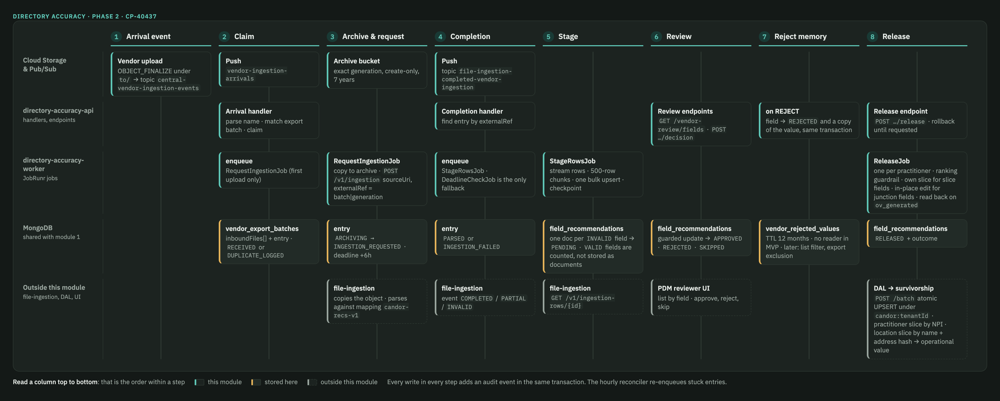

# Design: Vendor ingestion — arrival events, file ingestion through the file-ingestion service, staging, review, and release

> Confluence: [CP-40437 - Design: Directory accuracy vendor ingestion](https://certifyos.atlassian.net/wiki/spaces/Engineerin/pages/2302345225/CP-40437+-+Design+Directory+accuracy+vendor+ingestion) (published 2026-10-19; refresh with `publish_confluence_page.py --apply`).

## Purpose and scope

One question per vendor response file: **did the vendor's file arrive, what did it recommend, what did a reviewer decide, and what reached the Golden record?**

**This module owns:**

- **Arrival** — learn that a vendor file landed in a watched bucket, through a storage event, never by listing folders on a timer.
- **Archive** — keep the exact bytes of every file we act on, for 7 years.
- **Ingestion by delegation** — hand the archived file to the file-ingestion service; learn the result through its completion event.
- **Staging** — read the parsed rows back, write one document per field the vendor wants changed, and hold it in this service's own store until a reviewer acts on it.
- **Review APIs** — list field recommendations by field, and approve, reject, or skip each one; the PDM reviewer UI consumes these.
- **Rejected-recommendations lookup** — remember rejected values so the same recommendation is not queued again.
- **Release** — write approved rows to the Golden record through Sync Latest, under `<vendor>:{tenantId}`.
- **Audit** — one event per lifecycle step, same transaction as the state change, kept 7 years.

**This module does not own:**

- The vendor buckets and their SFTP access — the shared SFTP platform, operated by DevOps.
- Parsing the file and validating its columns — the file-ingestion service (repository `file-ingestion-service`).
- The export batch and its export state — the vendor export module; this module reads the batch and adds its own inbound fields.
- Survivorship, merge, and dedup logic — the Golden-record engines, extended only.
- A reviewer UI — the PDM reviewer UI, a separate front-end application.

**One service, three modules — the decided names:**

- The service is the **directory accuracy service**, repository **`directory-accuracy-service`** (renamed from `vendor-exchange-service`). Vendor export (module 1), vendor ingestion (this module), and later attestation are modules inside it: one repository, one deployment, one database.
- Its two GCE instance groups are **`directory-accuracy-api`** (HTTP: handlers, review endpoints) and **`directory-accuracy-worker`** (JobRunr jobs). Module 1's design doc uses the same names.
- Module-specific names stay module-specific: collections such as `vendor_export_batches`, jobs such as `RequestIngestionJob`, paths such as `/v1/vendor-review/…`. Only the service and its deployables carry the `directory-accuracy` name.

**Markers used in this doc:**

- **File-ingestion supports this today** — exists; we only use it; the claim cites the code.
- **Needs file-ingestion change** / **Needs survivorship change** — does not exist today; listed in *Rollout*.
- **⚠ Proposed change to module 1** — a field added to the export module's data model.

**Two words used throughout:**

- **Guarded update** — an update that changes a row only if it is still in the expected state ("set `STAGING` only if `PARSED`"). If the state moved, nothing matches and the caller stops. Two workers can never act on the same row twice.
- **Field recommendation** — one document in `field_recommendations`: one thing the vendor says should change about one field of one practitioner (and one location, when the field belongs to a location). The reviewer decides per field recommendation.

## Section triage

| Section | Included | Reason |
| --- | --- | --- |
| Approach | Yes | Eight steps from arrival to release |
| Alternatives considered | Yes | Parser in this module, separate inbound table, last-upload-wins, one document per practitioner with fields nested, identity lookup at staging, own junction chain for location fields |
| Components and files touched | **No** | Pre-implementation design doc — no file lists yet |
| Contracts and interfaces | Yes | Arrival event and setup, handler, job payloads, file-ingestion calls and event, field levels and status rule, review endpoints, configuration |
| Data model and migration | Yes | Inbound files on the export batch, field recommendations, rejected-value memory, unmatched uploads |
| Security, privacy, and access | Yes | Provider PII at rest in archive and staging, service identities, reviewer permissions |
| Performance and scale | Yes | The 1M-row file (and its 500 MB cap problem); staging throughput; the review list under filters; release fan-out into the MDM pipeline |
| Observability | Yes | Event-driven arrival and completion both have a silent-failure mode (an event that never arrives) |
| Audit trail | Yes | **Added section** — every file, reviewer decision, and release must be answerable for 7 years |
| Failure modes and rollback | Yes | Duplicate and lost events, repeat uploads, file-ingestion refusals, double decisions, kill switch |
| Test strategy | **No** | Design phase; decisive cases are in Failure modes |
| Rollout | Yes | DevOps asks, file-ingestion asks, contract call asks, pilot order |

## Approach

**Quick review.** Two pages cover this document end to end; both are kept in sync with it:

- **Start with the [Vendor ingestion lifecycle flow](https://claude.ai/artifact/RimiMn1kUjGF4oPB67TMsG).** The eight steps as a swimlane board, then one card per step with what happens, why, and what fails. Read it before the Approach below; the board is also pasted right under this note.
- **Then open the [Vendor ingestion data model](https://claude.ai/artifact/RYgTKAdM6PQ7UKBspVTcpj).** Every collection this module creates or touches, the keys in plain words, sample documents, the twelve-row table view, and the indexes.
- **Come back here for the contracts.** Endpoints, payloads, configuration keys, failure modes, and the Rollout asks live only in this document.



*The lifecycle board from the flow page. Read a column top to bottom: that is the order within a step. Teal = this module, amber = stored here, grey = outside this module.*

This module runs on the directory accuracy service's two GCE instance groups, shared with vendor export: the arrival and completion handlers and the review endpoints join `directory-accuracy-api`; the request, staging, release, and reconciler jobs join `directory-accuracy-worker` (JobRunr).

**1. Arrival event — every vendor upload publishes one message.**

- **What:**
  - Each vendor bucket has a notification pointing at the Pub/Sub topic `central-vendor-ingestion-events`.
  - The notification is filtered two ways, so only a finished vendor upload produces a message:
    - Event type `OBJECT_FINALIZE` only — fires when an object is fully written. Deletes and metadata edits fire other event types and are not sent.
    - Object prefix `to/` only — the folder the vendor writes to. Our own export files land in `from/` and are not sent.

**2. Receive, match, claim, enqueue.**

- **What:**
  - Push subscription `vendor-ingestion-arrivals` posts each message to `/internal/vendor-ingestion/arrivals` on the api group. The handler checks the Pub/Sub identity token and reads the message attributes only.
  - It parses the object name `to/<tenantId>/<tenantId>_<exportBatchRef>_<vendorBatchId>_<yyyyMMdd>.csv` and looks up `vendor_export_batches` by `exportBatchRef`. Folder tenant, filename tenant, and batch tenant must agree, and the batch must have a placed file.
  - It claims the upload with one conditional update: add an entry to the batch's `inboundFiles[]` only if no entry already has this `uploadId` (bucket + object name + generation). If nothing matched, the upload was already claimed: acknowledge and stop.
  - The **first upload for the batch** gets state `RECEIVED`. Every later upload is added as `DUPLICATE_LOGGED`, counted, and not processed.
  - After the write commits, for `RECEIVED` only: enqueue `RequestIngestionJob(exportBatchId, uploadId)`, then return `2xx`, which acknowledges the message.
  - A file that does not match any batch or has a bad name is written to `vendor_unmatched_uploads` with a reason, for an operator. It is never acknowledged and forgotten.
- **Why first upload is truth:** one processed upload per batch; repeat uploads stay visible in the array and in a metric. Processing a logged upload is an open business decision.
- **Why push:** the api group already has token-checked endpoints; `2xx` acknowledges, `5xx` retries, five failures go to a dead-letter topic (a holding topic for undeliverable messages); no polling thread (module 1 D7).
- **Why enqueue, not call file-ingestion here:** the handler must answer inside the Pub/Sub deadline; the request belongs on a job with retries over hours.
- **What if it fails:**
  - Crash before commit: redelivery claims normally. Crash after commit, before enqueue: entry `RECEIVED` without `jobId`; the hourly reconciler enqueues it.
  - Redelivery of a claimed entry: `RECEIVED` without `jobId` enqueues; anything else is a no-op.
  - Five failed deliveries: dead-letter topic, alert, operator replay; the object is still in the bucket.

**3. `RequestIngestionJob` — archive, then hand file-ingestion the archive location.**

- **What:**
  - Worker group. Guarded update `RECEIVED → ARCHIVING`.
  - Copy the exact generation to `gs://<archive bucket>/<tenantId>/<exportBatchId>/<generation>/<filename>`, create-only; record `archive.path`.
  - Register: `POST /v1/ingestion` with `mappingId` (`candor-recs-v1`), `filename`, `sourceUri` = archive path, `externalRef = <exportBatchId>|<generation>`, `meta`. File-ingestion copies the object into its own bucket and answers with an `ingestionId`. No bytes pass through this module.
  - Guarded update `ARCHIVING → INGESTION_REQUESTED`; schedule `DeadlineCheckJob` at `+ingestionDeadlineHours`.
  - File-ingestion now owns the file: format check, header check against our mapping, parse, store rows, publish a completion event.
- **Why we archive, not file-ingestion:** we own the audit obligation; the vendor can delete or overwrite in `to/`; file-ingestion's copy expires.
- **Why `externalRef` is batch id plus generation:** a repeated `externalRef` returns the same ingestion, so retries are safe; the generation is Cloud Storage's unique version number of this upload. No upload step, so no expiry, so no attempt counter.
- **Why file-ingestion fetches, not us uploading:** one server-side copy instead of 500 MB through our worker; nothing to expire; file-ingestion's receiver unchanged after the copy. **Needs file-ingestion change** (*Rollout* ask 9).
- **Why file-ingestion, not a parser here:** it already does format check, header check, column rules, parse at about 3,000 rows a second, retry, completion event. Our rules run on its rows in step 5.
- **What if it fails:**
  - Archive copy fails: retry; `412` means already archived.
  - Register times out after it landed: retry with the same `externalRef` gets the existing ingestion.
  - File-ingestion cannot read the archive object: retry; after retries `FAILED` `SOURCE_UNREADABLE`, alert.
  - Source object gone before archive: `FAILED` `SOURCE_MISSING`, alert.
  - File-ingestion ends `INVALID` and the same bytes need a second run: the ref is used up; needs a new vendor upload. Known limit for MVP.

**4. Completion event — learn the outcome from file-ingestion.**

- **What:**
  - File-ingestion publishes one event per finished ingestion to our consumer topic `file-ingestion-completed-vendor-ingestion`. Push subscription `vendor-ingestion-completions` posts it to `/internal/vendor-ingestion/completions`.
  - The handler finds the entry by `externalRef`. Guarded update `INGESTION_REQUESTED → PARSED` on `COMPLETED` or `PARTIAL`, or `→ INGESTION_FAILED` on `INVALID`, with the counts or the reason. Deletes the deadline job.
  - On `PARSED`: enqueue `StageRowsJob(exportBatchId, uploadId)`.
  - `DeadlineCheckJob` is the only fallback: if still `INGESTION_REQUESTED` at the deadline, one `GET /v1/ingestion/{id}`; same pattern as module 1 D8.
- **Why push here too:** the handler does one small write and one enqueue, well inside the deadline; the topic is ours alone, so no filter; same reasons as step 2.
- **What if it fails:**
  - Event lost: the deadline check catches it; `completionSource = DEADLINE` on the entry.
  - Duplicate event: the guarded update matches nothing; done.
  - Event for an unknown `externalRef`: counted, acknowledged; not ours.

**5. `StageRowsJob` — read the rows back, write one document per field.**

- **What:**
  - Worker group. Guarded update `PARSED → STAGING`.
  - Stream `GET /v1/ingestion-rows/{ingestionId}` from the saved cursor. Each line is one wide row: one practitioner, one location, every field we sent with the vendor's status and value.
  - Every field the vendor marked `INVALID` becomes one document in `field_recommendations`, `reviewStatus = PENDING`. Practitioner-level fields are written once per practitioner; location-level fields once per location.
  - Every field the vendor marked `VALID` is counted on the inbound-file entry, not stored as a document. The archived file is the record of what the vendor confirmed.
  - Row checks first, all local to the row, no lookups: file-ingestion `INVALID` → `SCHEMA_INVALID`; `certify_practitioner_id` or `npi` blank, or `certify_location_id` blank on a location-level field → `MISSING_IDS`; `entity_type` not `PRACTITIONER` → `UNSUPPORTED_ENTITY`. Rejected rows are counted on the entry by disposition; the rows themselves stay in the archived file and in file-ingestion's row store for its retention.
  - The echoed ids are trusted at staging. They are ours; the platform is consulted where it is cheap: on the reviewer's screen when a row is opened, and at release, where a stale id fails for that one practitioner.
  - **Ids are built from the data, never generated.** `field_recommendations._id` = `tenant | source | exportBatchId | certifyPractitionerId | certifyLocationId or - | field`. The same input always produces the same id. Kept as a readable string, not a hash: every part is a short platform id or a field name, so the key is safe and under 120 bytes, and a readable key answers "which practitioner, which field, which batch" and serves prefix reads by batch or practitioner from the primary index. Hashing would save a few percent of index size and cost both.
  - **Writes are batched and idempotent.** Collect `stageChunkRows` wide rows; build their documents in memory, merging a practitioner's repeated fields into one; send one unordered bulk write of `updateOne(..., { upsert: true })` per document; then one checkpoint update on the inbound-file entry. A document that already exists with the same id is updated in place, never duplicated. No transaction needed.
  - End of stream: counts reconcile against `populatedRows`; `POST /v1/ingestion-complete/{id}`; guarded update `STAGING → STAGED`.
- **Why one document per field:** status is decided per field; the review list filters and pages by field; one indexed query serves it at any tenant size. The per-practitioner view is a cheap grouping of these documents when a screen wants it.
- **Why confirmations are not documents:** about 85% of fields come back `VALID` and are never reviewed; storing them would multiply storage by five for nothing the queue reads. The count on the entry and the archived file answer "what did the vendor confirm". If confirmations are wanted as documents later, it is one condition in the staging builder: write `VALID` fields with the same document shape, `vendorStatus = VALID`, `reviewStatus = NOT_REQUIRED`; nothing else in the model or the endpoints changes, only storage grows by about five times.
- **Why chunked bulk writes:** thousands of large writes instead of millions of small ones; the checkpoint keeps retry cheap.
- **What if it fails:**
  - Crash mid-stream: retry from `checkpoint.after`; redone rows land on the same ids.
  - Rows expired in file-ingestion before staging: `FAILED` `ROWS_EXPIRED`; alert; the archive has the bytes.
  - Count mismatch: `FAILED` `COUNT_MISMATCH`; a code defect, alert.

**6. Review API — list by field; approve, reject, or skip one field.**

- **What:**
  - `GET /v1/vendor-review/fields` — one page of `field_recommendations`, filters `field`, `reviewStatus`, `npi`, `exportBatchId`; keyset pagination (next page starts after the last row seen, so decided rows never shift a page). Default `reviewStatus = PENDING`.
  - `GET /v1/vendor-review/fields/summary` — counts per field and status for the filter chips.
  - `GET /v1/vendor-review/practitioners/{certifyPractitionerId}` and `GET /v1/vendor-review/npis/{npi}` — all of one practitioner's documents for a batch, grouped in code; the NPI form serves screens that start from an NPI.
  - `POST /v1/vendor-review/fields/{id}/decision` — `{ action: APPROVE | REJECT | SKIP, comment, version }`. One guarded update: current `reviewStatus` must allow the action and `version` must match, else `409`. Comment mandatory on `REJECT`. Audit event in the same transaction.
  - `APPROVED` and `REJECTED` are final. `SKIPPED` is a marker only: can still be approved or rejected; no effect on release or the next export.
  - Bulk: `POST /v1/vendor-review/decisions`, same rule per item, per-item results.
- **Why the guarded update:** two reviewers, a double click, or a retried request must produce one decision; only the database can promise that.
- **Why keyset pagination:** rows leave the pending list as they are decided; page numbers would skip or repeat.
- **What if it fails:**
  - Decision after another reviewer's final decision: `409` with the current row.
  - Reject without a comment: `400`.

**7. Rejected-value memory — keep a durable copy of every rejection.**

- **What:**
  - On every `REJECT`, two writes in one transaction: the field document becomes `REJECTED` (step 6), and `vendor_rejected_values` is upserted by a key with no batch id in it: tenant, practitioner, location (or none), field, hash of the normalised value. The row keeps the value as received and normalised, first and last rejection time, count, who and why last, which batch and document last, a short `rejections[]` list, and `expiresAt` = last rejection + `rejectedValueTtlMonths` (default 12).
  - Because the key has no batch id, the same value rejected in October and again in December is one row with `rejectionCount = 2` and `lastRejectedAt` in December; a future reader answers "rejected before, when, how often" from one `_id` read.
  - Normalisation is per field and versioned: phones to digits only; addresses trimmed, upper-cased, punctuation removed, `Suite`/`Ste` folded; lists such as specialties sorted; booleans to `true`/`false`. The version number is stored on every row.
  - A MongoDB TTL index on `expiresAt` removes the row after 12 months.
  - **Nothing reads this table in MVP.** Staging writes every `INVALID` field as `PENDING`; the review list shows everything. The table is memory for two later uses, each a separate decision: a `hideRejected` filter on the list endpoint, and an exclusion input for module 1's saved filter so a rejected field or location is not sent to the vendor next cycle.
- **Why a separate copy when the field document is already `REJECTED`:** `field_recommendations` may later be given a short life (a 30-day TTL, or cleared when the next export's results arrive). The rejection memory must outlive it, with the identifiers intact.
- **Why a table, not a hash:** v2 D2-07; exact match on readable columns, index-served, auditable ("show me everything rejected for this practitioner").
- **Why a TTL:** a value rejected once is not wrong forever; after a year it should be forgotten. The rejection itself stays in the audit trail for 7 years.
- **What if it fails:**
  - The second write fails: the transaction rolls back; the reject is retried; the field stays `PENDING` until both land.
  - Normalisation rule changes: new rows carry the new version; old rows keep theirs. A rule change never rewrites history.

**8. Sync Latest — release approved fields to the Golden record under `candor:{tenantId}`.**

- **What:**
  - Reviewer action, per field or in bulk: `POST /v1/vendor-review/fields/{id}/release`, `POST /v1/vendor-review/releases`. Only `APPROVED` fields. Fields are grouped per practitioner under one `releaseId`; `ReleaseJob(tenantId, certifyPractitionerId)` on the worker, one job per practitioner at a time. Field states: `RELEASE_REQUESTED → RELEASING → RELEASED | RELEASE_FAILED`. Release state lives on the field documents; there is no separate release collection.
  - **Ranking guardrail first:** the tenant's survivorship configuration must rank `candor`; otherwise `RANKING_MISSING`, nothing written (v2 D2-18; unranked falls to 997).
  - **Same conventions as roster and the tenant UI.** Slices are written the way the platform's own sources write them: `sourceType` `<source>:{tenantId}` (`candor:{tenantId}` today; one name per vendor, never a shared `vendor:`), crosswalk ids built by the platform's recipe, the source registered in `core_sources` with `tenantId` set. Nothing new is invented for Candor.
  - **Two kinds of field.** A field either lives on a sourced table (a slice: `CorePractitioner`, `CoreLocation`, `CoreEntityAddress`) or on a junction row that links them (`GroupPractitionerLocation`, its network copy, specialty links), which has no source and no survivorship. Slice fields are released as our own slice; junction fields are edited in place, the same way the tenant UI edits them.
  - **Practitioner-level slice fields** (`first_name`, `last_name`): one `CorePractitioner` slice, `crosswalkId` = NPI, exactly as the tenant UI's practitioner edit. The slice `data` always carries `npi`, `firstName`, `lastName`, because matching joins a slice to the Golden record by `data.npi` plus name sound, never by crosswalk id. Released fields overlay those.
  - **Name corrections need the matching (MDM) team before build.** A corrected name that sounds different (`Bob` → `Robert`) fails the match and creates a second practitioner. Until matching joins `candor:` slices by NPI (Rollout ask 13, to be agreed with the matching and survivorship teams), such releases are refused with `NAME_SOUND_CHANGED`.
  - **Location-level slice fields** (`phone`, `fax`): one `CoreLocation` slice for the location, shared by every practitioner at that location. Crosswalk id = the platform's recipe over the Golden location's current name and service address; the slice carries that name and address unchanged plus the corrected contacts, with a `CoreEntityAddress` slice and a service-address link, so matching joins it to the existing Golden location. Writing a location field once covers every practitioner there.
  - **Junction fields, edited in place** (`accepting_new_patients`, `pcp_at_location`, `specialties`): the existing row for this practitioner at this location is updated through the api-layer endpoints the tenant UI uses (`PUT /practitioners/{id}/locations`, specialty `PATCH`), never through a chain of our own. The directory read returns one row per junction row, so a second chain under our slice would show the location twice. Attribution for these lives in `goldenRecordUpdate` on our side; there is no contribution map for them.
  - **`practice_name` and address, edited in place too:** matching requires a location slice's name and service address to equal the Golden ones, so a corrected value as our own slice would create a new location. They are written into the existing location slice through `PUT /locations/update`, exactly as the tenant UI's location edit does (it reuses the roster or tenant slice, `LocationService.java:1573-1595`). A later own-slice route depends on Rollout ask 15.
  - **Read our own slice, merge, write it back whole:** read the practitioner's or location's current `candor:{tenantId}` slice from the DAL, overlay the fields in this release, write the whole slice with DAL `UPSERT` in one atomic batch. Never a sparse write (v2 D2-37); never `UPSERT_DATA`, which appends to arrays and would duplicate `contacts[]`.
  - DAL raises `mdm.slice.changed` on the write; cleansing, matching, survivorship run as for every source; survivorship raises `mdm.slice.ov_generated` once the operational value is written.
  - **Read back on the event, not a timer:** a push subscription on `mdm.slice.ov_generated`, filtered to events our `candor:` slice triggered, reads the operational value and its `contribution_map`; outcome per field `WON`, `OUTRANKED`, `NOT_APPLIED`. All three are `RELEASED`; the outcome is shown to the reviewer. A deadline check covers a lost event. In-place junction and location edits are read back directly from the row.
  - Removals (`INVALID` on `location` or `npi`, no replacement) belong to the Terminations engine (v2 §6.11); nothing is written for them in MVP.
  - Rollback: `POST /v1/vendor-review/fields/{id}/rollback`, `APPROVED → PENDING` with history; refused once `RELEASE_REQUESTED`.
- **Why read-merge-write, not a sparse write:** DAL `UPSERT` replaces the whole slice (`CorePractitionerService.java:121-137`); writing only this month's phone would erase last month's name. Reading our own slice first keeps every earlier release; the DAL slice is the one record of what this source has released.
- **Why one job per practitioner at a time:** the DAL has no version field on a slice; its lock is the row's `updated_at`, applies only to non-atomic batches, and gives up with `500` after ten tries. Serialising per practitioner on our side (deterministic job id) removes the race instead of relying on that lock.
- **Why our own release worker (v2 O-19):** our documents live here, keyed by export batch; the attestation module's sync works from its own store. Sharing would copy rows across services for one DAL call.
- **Why read back:** survivorship answers `200` with `status: error` on failure (`SurvivorshipResource.java:252-267`) and runs asynchronously. The operational value is the only proof.
- **Why `mdm.slice.ov_generated`, not `mdm.slice.changed`:** the DAL raises `mdm.slice.changed` the moment our slice is written, before cleansing, matching, and survivorship have run; reading then shows the old value. Survivorship's event comes after the operational value is written and names the triggering source, so it is the signal to read.
- **Why in place for junction fields, not our own rows:** the directory query returns one row per `GroupPractitionerLocation` reachable from the practitioner's contributing slices (`practitioner-group-practitioner-locations.sql`); a second chain under our slice is a second row for the same location, with no rule to pick between them. The tenant UI writes the existing row for the same reason (`PractitionerService.java:8436-8460`).
- **What if it fails:**
  - DAL rejects the batch (`4xx`), or the practitioner or location no longer exists: `RELEASE_FAILED` `UNKNOWN_ENTITY` or the DAL error; fields back to `APPROVED`; counted per batch.
  - DAL or Pub/Sub down: retries with backoff; exhausted → `RELEASE_FAILED`, alert.
  - `OUTRANKED` or `NOT_APPLIED`: not a failure; recorded; reported per batch.
  - A name correction that changes how the name sounds (`Bob` → `Robert`): matching does not join the slice, a new practitioner is created. Guarded by the matching ask (Rollout ask 13); until it lands, `first_name` and `last_name` releases are compared by sound before the write and refused with `NAME_SOUND_CHANGED`.
  - A second release request while a job runs: the job claims every `RELEASE_REQUESTED` field of the practitioner when it starts; later requests enqueue the same job id again and run after it.
  - Crash after the DAL write, before the fields are marked: retry re-reads the slice, finds the values already there, and only marks the fields.

### Decisions

| ID | Decision | Instead of |
| --- | --- | --- |
| D1 | Arrival is learned from Cloud Storage `OBJECT_FINALIZE` notifications on the `to/` prefix, published to one topic, `central-vendor-ingestion-events` | Polling bucket listings; one topic per bucket or vendor; watching the whole bucket |
| D2 | Push subscriptions to the api group for arrivals, completions, and survivorship's `mdm.slice.ov_generated`, dead-letter after five attempts, acknowledge after commit | Pull subscriptions on the worker; acknowledge on receipt |
| D3 | Inbound uploads live in `inboundFiles[]` on the export batch row, one entry per bucket + object + generation; the claim is a conditional array push on `uploadId` | A separate inbound table; a single inbound slot on the batch; read then write |
| D4 | The first upload for a batch is processed; later uploads are logged as `DUPLICATE_LOGGED`, counted, and alerted on; nothing processes a logged upload until Product decides | Last upload wins with supersede of a running ingestion; operator promotion |
| D5 | Match by the `exportBatchRef` filename leg against `vendor_export_batches._id`, with three-way tenant agreement | Matching on the export file's name; "latest open batch for the tenant" |
| D6 | The handler claims and enqueues only; `RequestIngestionJob` archives and registers | Calling file-ingestion inside the push handler |
| D7 | This module archives the exact generation create-only, then registers with file-ingestion by archive location; file-ingestion copies the object server-side | File-ingestion reads `to/`; this module streams bytes to a signed upload URL; archiving after |
| D8 | Parsing and column validation are delegated to file-ingestion in mapped mode (`candor-recs-v1` mapping); completion by its event on our consumer topic, one deadline check as fallback | A parser in this module; status polling |
| D9 | `externalRef = <exportBatchId>\|<generation>`, deterministic per upload | A random id per call; the bare batch id; an attempt counter (only needed when an upload step can expire) |
| D10 | One document per field per practitioner (per location for location-level fields) in `field_recommendations`, written at staging with a deterministic `_id`, in bulk chunks with a checkpoint | One document per practitioner with fields nested; a MongoDB view over nested documents; one write per row |
| D11 | Only `INVALID` fields become documents; `VALID` fields and rejected rows are counted on the inbound-file entry, with the archived file as the record | One document per confirmed field; a confirmations collection; a rejects collection |
| D12 | One final decision per field (approve or reject), enforced by a guarded update on `reviewStatus` and `version`; skip is a revisitable marker; reject needs a comment; bulk decisions are per-item | Trusting the UI to prevent double decisions; skip as a final state |
| D13 | Review list pages by keyset on `(stagedAt, _id)`; a partial index on `reviewStatus in (PENDING, SKIPPED)` keeps the hot index small; the lifetime of `field_recommendations` itself is open (30-day TTL, or cleared per export cycle) | Page numbers; a full index over every status for seven years |
| D14 | Unmatched uploads are recorded with a reason, never discarded | Acknowledging and logging them |
| D15 | The vendor returns only the fields we sent; nothing vendor-only is stored | Staging `degrees`, taxonomy codes, and `candor_additional_location` rows |
| D16 | Every rejection upserts one row per distinct rejected value in `vendor_rejected_values` (key: tenant, practitioner, location, field, hash of the normalised value; no batch id), carrying first and last rejection, count, and a short history, with a 12-month TTL from the last rejection and a versioned normaliser; nothing reads it in MVP; later uses are a `hideRejected` list filter and an export exclusion input | A row per rejection; a key with the batch id (never matches next cycle); a fingerprint of the whole row; hiding matches at staging; relying on `field_recommendations` alone as the memory |
| D17 | Release is a reviewer action (per field or bulk), performed by this module's `ReleaseJob`; the attestation module's sync machinery is not reused | A scheduled sweep; the attestation module's sync worker (v2 O-19) |
| D18 | Every release reads the entity's current `candor:{tenantId}` slice from the DAL, merges the approved fields, and writes the whole slice back with `UPSERT` in one atomic batch; one `ReleaseJob` per practitioner at a time; release state lives on the field documents | Sparse writes; `UPSERT_DATA` deep merge (appends arrays); relying on the DAL's `updated_at` lock; a separate ledger, release, and lock collection |
| D19 | Release outcome is read back from the operational value and its contribution map (`WON`, `OUTRANKED`, `NOT_APPLIED`) when survivorship's `mdm.slice.ov_generated` event for our slice arrives; a deadline check covers a lost event | Trusting survivorship's `200`; a fixed delay; reading on the DAL's `mdm.slice.changed`, which fires before survivorship runs |
| D20 | A tenant with no `candor` entry in its survivorship ranking cannot release; the guardrail runs before the first write | Letting the unranked source fall to rank 997 |
| D21 | Slices follow the platform's own conventions: one source name per vendor (`<source>:{tenantId}`, `candor:{tenantId}` today); `CorePractitioner` crosswalk = NPI with `npi`, `firstName`, `lastName` always in `data`; `CoreLocation` crosswalk = the platform's name + service-address recipe with a `CoreEntityAddress` slice and service link; source row in `core_sources` with `tenantId` | A shared `vendor:{tenantId}` source (two vendors would overwrite each other's slice and be indistinguishable in ranking and the contribution map); our own crosswalk scheme; a practitioner slice holding only the corrected field |
| D22 | Slice fields (`first_name`, `last_name`, `phone`, `fax`) are released as our own slice. Junction fields (`accepting_new_patients`, `pcp_at_location`, `specialties`) and `practice_name` / address are edited in place through the api-layer endpoints the tenant UI uses; attribution for those lives on our field document | A junction chain of our own under the candor slice (shows the location twice in the directory); a candor location slice with a corrected name or address (creates a new location); holding those fields until the platform adds a sourced model |

## Alternatives considered

Each alternative: how it would work, what it does well, what it costs, why it lost. These are the options that competed during design; the Decisions table carries the smaller ones in its *Instead of* column.

### Parse the vendor file in this module

- **How it would work:**
  - The worker streams the object from the bucket, parses CSV or XLSX, checks the 59-column header, validates each column, and writes `field_recommendations` directly.
  - One job per upload; no second service, no completion event.
- **What is good about it:** one hop fewer; no `sourceUri` change in file-ingestion (Rollout ask 9); row errors land in our own tables.
- **What it costs:**
  - A second parser for the same formats file-ingestion already handles: size gates, macro and zip guards, XLS refusal, header checks, column rules, 30-day row retention (`receiver/FormatGates.java`, `mapping/validators/ValidatorFactory.java`).
  - 500 MB files stream through our worker; memory and timeouts become ours.
  - Every new vendor column rule is code here instead of a mapping row there.
- **Why it lost:** file-ingestion parsed 20,000,000 rows in 1 h 51 min on internal and exists for exactly this; we keep a mapping and a stage job, not a parser. The one thing it needs from file-ingestion is `sourceUri`, a small change on their side.
- **Cost line:** roughly two weeks of parser and validation work plus permanent ownership, against one file-ingestion ask and one mapping.

### A separate `vendor_inbound_files` collection

- **How it would work:**
  - One document per upload, `_id = uploadId`, with a reference to the export batch; the batch row is untouched.
  - The claim is an insert that fails on a duplicate key.
- **What is good about it:** no change to module 1's collection; a plain collection to index and page; no array growth on the batch row.
- **What it costs:**
  - Every question is a join: "has this batch received a file", "is this the first upload", "how many duplicates" all need two reads or a lookup.
  - The first-upload rule needs a count or a transaction across two collections; the array version is one conditional push.
  - Operators looking at a batch see no inbound state on it.
- **Why it lost:** a batch has one to a handful of uploads, never thousands; an array on the batch answers every question in the batch read and makes the claim a single atomic update (`$push` guarded by `uploadId`). The change to module 1 is additive and marked ⚠.
- **Cost line:** about the same build; the array saves a collection, an index set, and a cross-collection transaction forever.

### Last upload wins

- **How it would work:**
  - A later upload for the same batch supersedes the earlier one: the running ingestion is cancelled or allowed to finish, its documents are deleted or marked superseded, and the new file is staged.
  - Alternatively both are staged and the reviewer sees the newer value.
- **What is good about it:** a vendor can correct a bad file by re-uploading; no operator conversation.
- **What it costs:**
  - Reviewers may already have decided fields from the first file; superseding them silently loses decisions, keeping them means two answers per field.
  - Cancelling a running `StageRowsJob` and cleaning 1.2M documents is a second state machine.
  - A partial file followed by a complete one and a complete file followed by a stale re-send look identical to the system.
- **Why it lost:** the first upload is processed, later ones are logged, counted, and alerted (D4); the reviewer's work is never overwritten by a second file. Whether a logged upload can ever be processed is an open business decision, and the vendor's completeness signal (Rollout ask 5) removes the partial-file case at the source.
- **Cost line:** supersede adds cancellation, cleanup, and a reviewer-facing merge; log-and-alert adds one state and one metric.

### One document per practitioner, fields nested

- **How it would work:**
  - One document per practitioner per batch holding `fields: { phone: {...}, fax: {...} }` and `locations[]` with their fields.
  - The review list runs an aggregation (`$unwind` on fields and locations, `$match` on status) or reads a MongoDB view defined over that pipeline.
- **What is good about it:** fewer documents (one per practitioner, not ten); the practitioner screen is one read; the shape mirrors the vendor's wide row.
- **What it costs:**
  - A status change on one field is an update inside a nested array with positional operators and a per-document version, so two reviewers on two fields of the same practitioner collide.
  - The list ("all `PENDING` phones, newest first, page 3") cannot use an index on a nested array field for keyset paging; it unwinds every candidate document on each request. A view does not change that: a standard view is the same pipeline run per query and cannot carry its own indexes; an on-demand materialised view is a copy refreshed by a scheduled `$merge`, so it is stale between refreshes and doubles the storage.
  - Every filter the UI adds (field, status, batch, NPI) is pipeline work, not an index hit.
- **Why it lost:** the review queue is a field-level queue: filter, page, decide, release per field. One document per field makes each of those a direct indexed read or a single guarded update, and a 1M-row file is about 1.2M small documents, which the partial index on `(PENDING, SKIPPED)` keeps cheap. The practitioner and NPI views are one indexed query each.
- **Cost line:** nested saves documents and costs an aggregation per list page and positional updates; per field costs documents and makes every path an index hit.

### Identity lookup at staging

- **How it would work:**
  - `StageRowsJob` calls the api-layer for every row to confirm the practitioner and location still exist and belong to the tenant before writing a document.
  - Rows that fail are dispositioned `NOT_IN_EXPORT` or `UNKNOWN_ENTITY` at staging.
- **What is good about it:** stale ids never reach the reviewer; the queue is clean on arrival.
- **What it costs:**
  - One api-layer call per row, or per practitioner: a 1M-row file is hundreds of thousands of calls on the shared api-layer during staging, which is exactly when the file is largest.
  - Module 1 keeps no per-NPI registry: egress resolves the saved filter and keeps its frozen list 7 days only, so the only lookup is the api-layer.
  - The check is repeated at release anyway, because an entity can merge or terminate between staging and release.
- **Why it lost:** the ids are ours, echoed back under a mandatory contract (Rollout ask 5); staging trusts them and does no lookup. A stale id fails once, at release, as `UNKNOWN_ENTITY`, and shows on the reviewer's screen, which reads the practitioner at request time.
- **Cost line:** removes the heaviest api-layer load of the whole module; adds one failure reason at release.

### Our own junction chain and location slices for every location field

- **How it would work:**
  - For each practitioner-location pair, release writes a `candor:` `CoreLocation` and `CoreEntityAddress` slice plus a chain of `TenantPractitioner → TenantGroupPractitioner → GroupPractitionerLocation → TenantGroupLocation → GroupLocation` rows under our slices, and puts `accepting_new_patients`, `pcp_at_location`, `practice_name`, and the address on them.
  - Every corrected field then lives on something we own, with our attribution.
- **What is good about it:** one write path for all fields; nothing written into roster's or the UI's rows; clean source attribution.
- **What it costs:**
  - The directory read returns one row per `GroupPractitionerLocation` reachable from the practitioner's contributing slices (`practitioner-group-practitioner-locations.sql`): a second chain is a second row for the same location, with no rule to pick a value between them.
  - A `CoreLocation` slice with a corrected name, or an address slice with a corrected address, never matches the existing Golden location (`location.drl:68-130`); survivorship creates a new location instead of correcting the old one.
  - The tenant UI avoids both problems by editing the existing rows (`PractitionerService.java:8436-8460`; `LocationService.java:1573-1595`).
- **Why it lost:** slice fields (`first_name`, `last_name`, `phone`, `fax`) are released as our own slice, where the platform's model supports it; junction and name/address fields are edited in place through the api-layer endpoints the UI uses (D22). Attribution for those lives on our field document; an own-slice route for them waits on matching (Rollout asks 15–16).
- **Cost line:** own chain is more rows per release and a duplicate location on every read; in-place is three api-layer calls and no new read path.

## Contracts and interfaces

**Where the endpoints live:**

- `directory-accuracy-api` instance group. The worker group has no endpoints.
- `/internal/…` — Pub/Sub identity token of the matching push subscription only.
- `/v1/vendor-review/…` — platform JWT with `vendor-review:read` (lists), `vendor-review:decide` (decisions), `vendor-review:release` (release, rollback). Tenant comes from the token, never the query.

**File-ingestion facts this section relies on** (repository `file-ingestion-service`, verified 2026-10-16):

| Fact | Where |
| --- | --- |
| Register today returns `201` with `ingestionId` and a signed `PUT` URL, valid 60 minutes, create-only on file-ingestion's bucket; there is no way to name a source object. **Needs file-ingestion change:** accept `sourceUri` and copy server-side | `registrar/RegistrationService.java:91`; `registrar/UploadUrlSigner.java:36-39`; `config/FileIngestionConfig.java:10` |
| A repeated `externalRef` for the same consumer returns the existing ingestion (`200`), with a new URL while it is `REGISTERED` | `registrar/RegistrationService.java:49-56` |
| A registration never uploaded expires after 24 hours (not reachable once file-ingestion copies at register time) | `config/FileIngestionConfig.java:11`; `sweep/IngestionSweep.java:125` |
| File-ingestion's own receiver claims the upload by object generation, checks size and format, parses | `receiver/ReceiverService.java:83-91`; `receiver/FormatGates.java:24-25` |
| Max file 500 MB; two parallel parses per consumer; rows kept 30 days by default | `config/FileIngestionConfig.java:16, 22-23` |
| Mapped mode: header checked against the mapping (missing or duplicate columns reject the file); column rules `required`, `digits`, `maxLength`, `enum`, `date`, `regex` | `parse/StructureValidator.java:16-20`; `mapping/validators/ValidatorFactory.java:27-32` |
| Terminal status `COMPLETED` when no row failed a rule, `PARTIAL` otherwise, `INVALID` on refusal | `parse/CompletionService.java:51`; `receiver/ReceiverService.java` |
| Completion event on the consumer topic `file-ingestion-completed-<identifier>`; body has `externalRef`, `meta`, `counts`, `rows` path; attributes `ingestionId`, `tenantId`, `identifier`, `status` | `consumer/ConsumerRules.java:14`; `parse/CompletionPublisher.java:112-134` |
| Rows readable only once `COMPLETED`, `PARTIAL`, or `CONSUMED`; 1,000 per page or one JSON object per line; cursor `after=<sheet>:<row>` | `registrar/IngestionRowsResource.java:45-48, 137` |
| Mark consumed is optional and idempotent | `registrar/IngestionReadService.java:26, 43-52` |
| Every `/v1/*` call carries `tenant-id` and `identifier` headers and names a registered consumer | `auth/UserContextFilter.java:51-83` |

### The lifecycle, end to end

> Order: arrival event → claim and enqueue → archive and register → completion event → stage fields → review → rejected-value memory → release. Rationale per step: *Approach*, same numbers.

**Step 1 — Arrival event (Cloud Storage → `central-vendor-ingestion-events`).**

Message attributes the handler reads (body is the object's JSON metadata, `JSON_API_V1`):

| Attribute | Meaning | Used for |
| --- | --- | --- |
| `bucketId` | Bucket the file landed in | Vendor and tenant lookup |
| `objectId` | Full object name, starting with `to/` | Path parse |
| `objectGeneration` | Version number of this write | Upload identity |
| `eventType` | `OBJECT_FINALIZE` | Guard: anything else is counted and acknowledged |
| `eventTime` | When the write completed | `eventTime` on the entry |
| `overwroteGeneration` | Present when the write replaced an object | Flag on the entry |

Setup, once per environment and once per bucket:

```bash
# Topic
gcloud pubsub topics create central-vendor-ingestion-events

# Cloud Storage publishes as the project's service agent; grant it on the topic only
gcloud storage service-agent --project=PROJECT_ID
gcloud pubsub topics add-iam-policy-binding central-vendor-ingestion-events \
    --member="serviceAccount:service-PROJECT_NUMBER@gs-project-accounts.iam.gserviceaccount.com" \
    --role="roles/pubsub.publisher"

# One notification per vendor bucket
gcloud storage buckets notifications create gs://VENDOR_BUCKET \
    --topic=central-vendor-ingestion-events \
    --event-types=OBJECT_FINALIZE \
    --object-prefix=to/
```

**Step 2 — Arrival handler (push subscription → api group).**

| Call | Does | Audit |
| --- | --- | --- |
| `POST /internal/vendor-ingestion/arrivals` | Reads attributes, parses the path, matches the export batch, adds the entry with the conditional update, enqueues `RequestIngestionJob` for a `RECEIVED` entry. `2xx` after commit, on an already-claimed entry whose state is past `RECEIVED`, and on non-`OBJECT_FINALIZE`; `5xx` on any error before commit (redeliver) | `INBOUND_FILE_RECEIVED`, `INBOUND_FILE_DUPLICATE_LOGGED`, or `INBOUND_FILE_UNMATCHED` with reason |

Path parse, from `objectId`:

| Leg | Example | Checked against |
| --- | --- | --- |
| Folder tenant | `to/org-xyz/` | Filename tenant; batch `tenantId` |
| `tenantId` | `org-xyz` | Folder; batch |
| `exportBatchRef` | `org-xyz-candor-2026-10-001` | `vendor_export_batches._id`; batch `file.path` set |
| `vendorBatchId` | `CB-2026-10-001` | Recorded; never load-bearing |
| `yyyyMMdd` | `20261015` | Recorded |

Claim, as one MongoDB update:

```js
db.vendor_export_batches.updateOne(
  { _id: exportBatchId, "inboundFiles.uploadId": { $ne: uploadId } },
  { $push: { inboundFiles: entry } }
)
// matchedCount 0 → already claimed; entry.state = inboundFiles.length === 0 ? "RECEIVED" : "DUPLICATE_LOGGED"
```

`UNMATCHED` reasons: `UNPARSEABLE_NAME`, `UNKNOWN_BATCH`, `TENANT_MISMATCH`, `BATCH_NOT_DELIVERED`.

Subscription: push with an identity token for the push service account; acknowledgement deadline 60 s; dead-letter to `vendor-ingestion-arrivals-dlq` after 5 attempts; retention 7 days.

**Step 3 — `RequestIngestionJob` (worker group) → file-ingestion.**

Job payload: `{ "exportBatchId": "org-xyz-candor-2026-10-001", "uploadId": "vendor-sftp|to/org-xyz/…csv|1760520000123456" }`.

Archive copy: `gs://<archive bucket>/<tenantId>/<exportBatchId>/<generation>/<filename>`, `ifGenerationMatch: 0` on the destination, source read by generation; `412` is success.

Register (headers `tenant-id: <tenantId>`, `identifier: vendor-ingestion`, the worker's bearer token):

```json
POST /v1/ingestion
{
  "mappingId": "<id of the candor-recs-v1 mapping>",
  "filename": "org-xyz_org-xyz-candor-2026-10-001_CB-2026-10-001_20261015.csv",
  "sourceUri": "gs://vendor-ingestion-archive/org-xyz/org-xyz-candor-2026-10-001/1760520000123456/org-xyz_org-xyz-candor-2026-10-001_CB-2026-10-001_20261015.csv",
  "externalRef": "org-xyz-candor-2026-10-001|1760520000123456",
  "meta": { "exportBatchId": "org-xyz-candor-2026-10-001", "uploadId": "vendor-sftp|to/org-xyz/…csv|1760520000123456" }
}
```

| Response | Meaning | Job does |
| --- | --- | --- |
| `201 { ingestionId, status: "RECEIVED" }` | New registration; file-ingestion copied the object | Guarded update to `INGESTION_REQUESTED` |
| `200 { … status: "RECEIVED" \| "PARSING" \| "COMPLETED" \| … }` | Same `externalRef` seen before | Guarded update if not yet |
| `4xx SOURCE_UNREADABLE` (proposed) | File-ingestion could not read `sourceUri` | JobRunr retry; after retries `FAILED` `SOURCE_UNREADABLE`, alert |
| `422 MAPPING_UNKNOWN` | Mapping id wrong for this consumer | `FAILED`, alert (configuration) |
| `503 SERVICE_DISABLED` | File-ingestion paused | JobRunr retry with backoff |

- No upload from this module.
- `meta` comes back unchanged on the completion event; `externalRef` is still the key.

**Step 4 — Completion event (`file-ingestion-completed-vendor-ingestion` → api group).**

| Call | Does | Audit |
| --- | --- | --- |
| `POST /internal/vendor-ingestion/completions` | Reads the body; finds the entry by `externalRef`; guarded update `INGESTION_REQUESTED → PARSED` (`COMPLETED`, `PARTIAL`) or `→ INGESTION_FAILED` (`INVALID`); stores `counts` or `reason`; deletes the deadline job; enqueues `StageRowsJob` on `PARSED`. `2xx` after the write or when the ref is unknown | `INBOUND_FILE_PARSED` or `INBOUND_FILE_INGESTION_FAILED` |

Event body (file-ingestion's contract, confirmed by its team 2026-10-16). Success, `COMPLETED` or `PARTIAL`:

```json
{
  "ingestionId": "01a0…",
  "tenantId": "org-xyz",
  "identifier": "vendor-ingestion",
  "status": "COMPLETED",
  "counts": { "populatedRows": 1000, "validRows": 998, "invalidRows": 2 },
  "externalRef": "org-xyz-candor-2026-10-001|1760520000123456",
  "meta": { "exportBatchId": "org-xyz-candor-2026-10-001", "uploadId": "…" },
  "rows": "/v1/ingestion-rows/01a0…"
}
```

Refusal, `INVALID` (`reason` in place of `counts`):

```json
{
  "ingestionId": "01a1…",
  "tenantId": "org-xyz",
  "identifier": "vendor-ingestion",
  "status": "INVALID",
  "reason": "STRUCTURE_REJECTED",
  "externalRef": "org-xyz-candor-2026-10-001|1760520000123456",
  "meta": { "…": "…" },
  "rows": "/v1/ingestion-rows/01a1…"
}
```

- Handler keys on `externalRef`; `meta` is our request echoed back; `identifier` is always ours because the topic is ours.
- Message attributes: `ingestionId`, `tenantId`, `identifier`, `status`.
- `INVALID` reasons: gate `OVERSIZE`, `MACRO_WORKBOOK`, `BAD_ZIP_CONTAINER`, `XML_DOCTYPE`, `LEGACY_XLS`, `NOT_DELIMITED_TEXT`; header `STRUCTURE_REJECTED`; sweep `PARSE_EXHAUSTED`.

Deadline check: `DeadlineCheckJob` at `+ingestionDeadlineHours`; one `GET /v1/ingestion/{ingestionId}`; writes the same fields with `completionSource = DEADLINE`.

**Step 5 — `StageRowsJob` (worker group) ← file-ingestion rows.**

Job payload: `{ "exportBatchId", "uploadId" }`. Read: `GET /v1/ingestion-rows/{ingestionId}?after=<checkpoint>` with `Accept: application/x-ndjson` (one JSON object per line); `429 TOO_MANY_STREAMS` → JobRunr retry after a short delay. Each line: `{ sheet, row, status, values: { <column>: { value, status, problems? } }, warnings? }`.

**The wide row, as the vendor sends it** (September 2026 sample, 59 columns): one row per practitioner × location we sent. Per field: the value we sent, `<field>_verification_status`, `<field>_candor_value`, `<field>_verification_reason`, `<field>_verification_confidence`, `<field>_verification_evidence`.

**Field levels:**

| Level | Fields | Written |
| --- | --- | --- |
| practitioner | `npi`, `first_name`, `last_name`, `specialties` | Once per practitioner; `location = null` |
| location | `location`, `practice_name`, `phone`, `fax`, `accepting_new_patients`, `pcp_at_location` | Once per location we sent |

**Vendor status → what is written:**

| `<field>_verification_status` | Written as |
| --- | --- |
| `INVALID` | One `field_recommendations` document, `reviewStatus = PENDING` |
| `VALID` | Counted on the inbound-file entry (`written.confirmedFields`); no document |
| `UNKNOWN`, `INCONCLUSIVE`, blank | Counted as unverified on the entry; nothing to review |

**Identity at staging:**

- `certify_practitioner_id`, `npi`, `certify_location_id` are taken as given: our ids, echoed by the vendor (*Rollout* ask 5 makes the echo mandatory).
- No api-layer call in `StageRowsJob`. A stale id surfaces at release as `UNKNOWN_ENTITY`, not at staging.

**Batching and idempotency in `StageRowsJob`:**

| Rule | How |
| --- | --- |
| Chunk | Read `stageChunkRows` wide rows (default 500) from the stream before writing anything |
| Build in memory | Turn the chunk into documents; a practitioner's repeated fields across its location rows collapse to one document each, so a chunk never carries two writes for one id |
| One bulk write | `bulkWrite([...], { ordered: false })` of `updateOne({ _id }, { $setOnInsert: {...all fields...}, $set: { updatedAt } }, { upsert: true })`; `$setOnInsert` so a re-stage never overwrites `reviewStatus`, `reviewHistory`, or `version` on a document that already exists |
| Checkpoint | After the bulk succeeds, one `updateOne` on the inbound-file entry: disposition counts and confirmed-field count added, `checkpoint.after` = last `sheet:row`; next chunk starts there |
| Retry | A crash before the checkpoint redoes the chunk; every write hits the same `_id` and is a no-op; a crash after it moves on |
| Practitioner spanning two chunks | Practitioner-level fields are written by whichever chunk sees the practitioner first; the next chunk's upsert finds the id and does nothing |

**How the ids are built** (every piece comes from the row and the batch, nothing random):

| Collection | `_id` | Example |
| --- | --- | --- |
| `field_recommendations` | `tenantId \| source \| exportBatchId \| certifyPractitionerId \| certifyLocationId or - \| field` | `org-xyz\|candor\|org-xyz-candor-2026-10-001\|cert-000123\|loc-7781\|phone` |
| same, practitioner-level field | location slot is `-` | `org-xyz\|candor\|org-xyz-candor-2026-10-001\|cert-000123\|-\|first_name` |
| `vendor_rejected_values` | `tenantId \| certifyPractitionerId \| certifyLocationId or - \| field \| sha256(normalizedValue)` — no batch id, so one row per distinct rejected value across cycles | `org-xyz\|cert-000123\|loc-7781\|phone\|7c9f3b2e…` |
| `inboundFiles[].uploadId` | `bucket \| objectName \| generation` | `vendor-sftp\|to/org-xyz/…csv\|1760520000123456` |

- The id is the identity: a repeated event, a retried chunk, or one practitioner on ten location rows all land on the same documents; the database discards the repeat.

Row dispositions (one per wide row):

| Disposition | When | Row goes to |
| --- | --- | --- |
| `STAGED` | File-ingestion `VALID`; ids present | `INVALID` fields to `field_recommendations`; `VALID` fields counted |
| `DUPLICATE` | Every document of this row already present with identical content | Nowhere; counted |
| `SCHEMA_INVALID` | File-ingestion `INVALID` (a column rule failed; `problems` names the field) | Counted; row stays in the archive and file-ingestion's store |
| `MISSING_IDS` | `certify_practitioner_id` or `npi` blank; or `certify_location_id` blank on a location-level field | Counted; location-level fields of a row missing only the location id are counted while its practitioner-level fields stage |
| `UNSUPPORTED_ENTITY` | Not a practitioner row | Counted; same |

Finish: `POST /v1/ingestion-complete/{ingestionId}` (idempotent), then guarded update `STAGING → STAGED`.

- Mapping `candor-recs-v1` (the 59 columns) is created once per environment through `POST /v1/mappings` and versioned in this repository. A second vendor is a second mapping plus a second adapter.

**Step 6 — Review endpoints (api group, platform JWT).**

| Call | Does | Audit |
| --- | --- | --- |
| `GET /v1/vendor-review/fields?field=&reviewStatus=&npi=&exportBatchId=&after=&limit=` | One page, newest staged first; `limit` 10 to 200, default 50; `after` = keyset cursor from the previous page's `next`. Default `reviewStatus = PENDING` | none |
| `GET /v1/vendor-review/fields/{id}` | One document with full evidence and history | none |
| `GET /v1/vendor-review/fields/summary?exportBatchId=` | Counts by `field × reviewStatus` | none |
| `GET /v1/vendor-review/practitioners/{certifyPractitionerId}?exportBatchId=` | All documents of one practitioner for a batch, grouped: `{ practitioner, fields: [ … ] }` | none |
| `GET /v1/vendor-review/npis/{npi}?exportBatchId=` | Same response, looked up by NPI (`tenantId, practitioner.npi` index). Without `exportBatchId`, the latest batch for the tenant | none |
| `POST /v1/vendor-review/fields/{id}/decision` | Body `{ "action": "APPROVE" \| "REJECT" \| "SKIP", "comment": "…", "version": n }`. `comment` mandatory on `REJECT` (`400` without). Guarded update: `version = n` and `reviewStatus` allows the action (`APPROVE`, `REJECT` from `PENDING` or `SKIPPED`; `SKIP` from `PENDING`), else `409` with the current document. `200` with the document | `FIELD_APPROVED`, `FIELD_REJECTED`, `FIELD_SKIPPED` |
| `POST /v1/vendor-review/decisions` | Body `{ "decisions": [ { id, action, comment, version } … ] }`, up to 200. Same rule per item; `207` with per-item status | one event per item |

- The list returns the stored document as is (*Data model*); page envelope `{ "items": [ … ], "next": "<cursor or null>" }`.
- Allowed moves: `PENDING → APPROVED | REJECTED | SKIPPED`; `SKIPPED → APPROVED | REJECTED`. `APPROVED` and `REJECTED` are final.

**Step 7 — Rejected-value memory.**

Written by the decision endpoint on `REJECT`, same transaction as the field recommendation update:

```json
{
  "_id": "org-xyz|cert-000123|loc-7781|phone|7c9f3b2e…(sha256 of normalizedValue)",
  "tenantId": "org-xyz",
  "certifyPractitionerId": "cert-000123",
  "certifyLocationId": "loc-7781",
  "field": "phone",
  "normalizedValue": "3036790177",
  "normalizationVersion": 1,
  "rawValue": "(303) 679-0177",

  "rejectionCount": 2,
  "firstRejectedAt": "2026-10-20T14:02:11Z",
  "lastRejectedAt": "2026-12-18T10:41:05Z",
  "rejections": [
    { "exportBatchId": "org-xyz-candor-2026-10-001", "by": "user:reviewer-7", "at": "2026-10-20T14:02:11Z", "reason": "Office confirmed old number still active" },
    { "exportBatchId": "org-xyz-candor-2026-12-001", "by": "user:reviewer-3", "at": "2026-12-18T10:41:05Z", "reason": "Still the old number; office confirmed again" }
  ],

  "expiresAt": "2027-12-18T10:41:05Z"
}
```

- **One row per distinct rejected value, not per rejection.** The `_id` has no batch id, so October's and December's rejections of the same phone land on the same row: `rejectionCount` goes up, `lastRejectedAt` moves, `rejections[]` gains an entry, `expiresAt` resets to 12 months from the latest. The write is an upsert by `_id`. Who rejected and why is the last entry of `rejections[]`; no field document id is kept, because field documents are short-lived.
- **Why the value is hashed in the `_id`:** an address or a specialties list can run to hundreds of characters and contain `|`; MongoDB caps index keys at 1,024 bytes. `sha256(normalizedValue)` keeps the key short and safe; the readable `rawValue` and `normalizedValue` sit on the row. The id parts before it stay readable on purpose.
- **How a later cycle finds it:** from any new `field_recommendations` document, build `tenantId | certifyPractitionerId | certifyLocationId or - | field | sha256(normalise(vendorValue))` and read by `_id`. No batch id, no scan, no join.

Normalisation rules, version 1 (the adapter owns them; a change bumps the version):

| Field | Rule |
| --- | --- |
| `phone`, `fax` | Digits only; leading `1` dropped when 11 digits |
| `first_name`, `last_name`, `practice_name` | Trim; upper-case; punctuation removed |
| `specialties` | Each entry trimmed and upper-cased; sorted; joined with `;` |
| `accepting_new_patients`, `pcp_at_location` | `true` / `false` |
| `location` | `address_line1|city|state|zip`: lines and city trimmed, upper-cased, punctuation removed, `SUITE`→`STE`, `STREET`→`ST`, `AVENUE`→`AVE`; state two letters; zip first five digits |

- Written only; no reader in MVP. Later readers: the list endpoint (`hideRejected=true` would leave out `PENDING` documents whose normalised value matches a live row) and module 1's saved filter (exclusion by practitioner, location, field). Each is its own decision.
- Index `(tenantId, certifyPractitionerId)` for the "everything rejected for this practitioner" report.

**Step 8 — Release (Sync Latest).**

| Call | Does | Audit |
| --- | --- | --- |
| `POST /v1/vendor-review/fields/{id}/release` | Body `{ "version": n }`. Guarded update `APPROVED → RELEASE_REQUESTED` with `goldenRecordUpdate.releaseId`; enqueues `ReleaseJob` for the practitioner (job id `release:<tenantId>:<certifyPractitionerId>`, so one runs at a time). `202 { "releaseId" }`. `409` if not `APPROVED` or stale version; `422 RANKING_MISSING` when the tenant's ranking has no `candor` entry | `FIELD_RELEASE_REQUESTED` |
| `POST /v1/vendor-review/releases` | Body `{ "ids": [ … ], "versions": { id: n } }` or `{ "exportBatchId", "all": true }` for every `APPROVED` field in a batch; up to 5,000 ids; one `releaseId` per practitioner; per-item result. `202` with the release ids | one event per field |
| `GET /v1/vendor-review/releases/{releaseId}` | The fields carrying that `releaseId`, with their state and outcome | none |
| `POST /v1/vendor-review/fields/{id}/rollback` | Body `{ "version": n, "reason": "…" }`. `APPROVED → PENDING`, history kept. `409` once `RELEASE_REQUESTED` or later | `FIELD_ROLLED_BACK` |

Where each field lives in the Golden record, and what the release writes:

| Field | Platform resource | Slice? | MVP |
| --- | --- | --- | --- |
| `first_name`, `last_name` | `CorePractitioner.data.firstName / lastName` | Yes, `crosswalkId` = NPI | Released |
| `phone`, `fax` | `CoreLocation.data.contacts[]`, shared by every practitioner at the location | Yes, crosswalk = `URLEncode(normalize(name))_<sha256 of service address>` | Released |
| `practice_name` | `CoreLocation.data.name` | Yes, but matching requires the name to equal the Golden location's; a corrected name as our slice creates a new location | In place: `PUT /locations/update` on the existing location slice, as the UI does |
| `location` (address) | `CoreEntityAddress` + `LocationEntityAddress` link | Yes, but matching requires the address to equal the Golden one; the tenant UI never overwrites a shared address (`LocationService.java:898-899`) | In place: `PUT /locations/update` with the new address; the api-layer links or creates the address row as for a UI edit |
| `accepting_new_patients`, `pcp_at_location` | `GroupPractitionerLocation.data`; `acceptingNewPatients` also on the network copy `TenantGroupLocationPractitionerNetwork`, which wins on read (`PractitionerLocationDirectoryResolver.java:103-115`) | No: junction row, no source, no survivorship | In place: `PUT /practitioners/{id}/locations` (GPL `UPSERT_DATA` by `tenantGroupPractitionerId` + `tenantGroupLocationId`, `PractitionerService.java:8436-8460`) |
| `specialties` | specialty junction rows | No | In place: `PATCH /practitioners/group-practitioner-location-specialties/specialty` |
| `npi` | identity key of the practitioner | A different NPI is a different practitioner | Removal path, ask 14 |

In-place edits carry `updatedBy = directory-accuracy` and our `releaseId` in the change reason; the next roster file can overwrite them exactly as it overwrites a UI edit today. Only slice fields take part in ranking.

`ReleaseJob(tenantId, certifyPractitionerId)`, worker group:

| Phase | Does | On failure |
| --- | --- | --- |
| Claim | Guarded update on every `RELEASE_REQUESTED` field of this practitioner: `→ RELEASING` | None matched: already done or rolled back; exit |
| Ranking check | Read the tenant's survivorship configuration; require a `candor` source in `sourceRanking` | `RELEASE_FAILED` `RANKING_MISSING`; fields back to `APPROVED` |
| Resolve | Read the Golden practitioner (NPI, names) and, for location fields, the Golden location (name, service address) by the echoed ids | Missing: `RELEASE_FAILED` `UNKNOWN_ENTITY` |
| Name guard | For `first_name` / `last_name`: compare the sound of the new name with the Golden one (same Soundex as the matching rule) | Differs: `RELEASE_FAILED` `NAME_SOUND_CHANGED` until Rollout ask 13 lands |
| Read own slice | `GET /core/practitioner/candor:<tenantId>/<npi>`; `GET /core/locations/candor:<tenantId>/<locationCrosswalk>`; `GET /core/entity-addresses/candor:<tenantId>/<addressHash>` | `404`: start from the seed below |
| Merge | Practitioner: seed `{ npi, firstName, lastName }` from the Golden record, overlay the slice read, overlay this release. Location: seed `{ name, contacts[] }` from the Golden location, overlay the slice read, overlay the corrected contact entries; address slice = the Golden service address unchanged | — |
| Write slices | DAL `POST /batch`, `transaction: true`, one `OperationRequest` per slice: `operation: UPSERT`, `body.sourceType: "candor:<tenantId>"`, `body.crosswalkId` as above, full `data`; plus `LocationEntityAddress { addressType: "service" }` linking the location and address slices on first write | `4xx`: `RELEASE_FAILED` with the DAL error; `5xx` or timeout: retry; "data unchanged" is success |
| Write in place | Junction and location fields through the api-layer, one call per endpoint: `PUT /practitioners/{certifyPractitionerId}/locations` (`accepting_new_patients`, `pcp_at_location`), specialty `PATCH`, `PUT /locations/update` (`practice_name`, address); service token; `changeReason = "directory-accuracy release <releaseId>"` | `4xx`: `RELEASE_FAILED` with the api-layer error for those fields only; slice fields are unaffected |
| Await | Slice fields wait for `mdm.slice.ov_generated` (handler below); in-place fields are read back from the row at once and finish | No event by `releaseReadBackDeadlineMinutes`: read once anyway; still absent → outcome `UNKNOWN`, alert |
| Finish | Fields `RELEASED` with `goldenRecordUpdate { releaseId, outcome, winningSource, releasedAt }` | — |

Push subscription `vendor-ingestion-ov-generated` on `mdm.slice.ov_generated` (survivorship's completion event), to the api group:

| Item | Value |
| --- | --- |
| Message | `OVCompletionPayload { certifyId, tenantId, entityType, crosswalks[], triggeringCrosswalks[{ certifyId, crosswalkId, sourceType, updatedAt }] }` in an `MDMEnvelope`; attributes `entityType`, `triggeringSourceTypes` (comma-joined) |
| Filter | `hasPrefix(attributes.triggeringSourceTypes, "candor:")` — a release of our slice is the only trigger of that run, so the attribute is our source alone; confirmed in Rollout ask 18 |
| Handler | Find `RELEASING` fields for `(tenantId, certifyId)`; read the operational value with `contribution_map`; per field `WON` (our source holds it), `OUTRANKED` (another source holds it, named), `NOT_APPLIED` (our slice absent from the map); mark `RELEASED`; acknowledge |
| Not ours | No `RELEASING` field for the id: acknowledge, nothing else |

DAL, matching, and survivorship facts this step relies on (repositories `fe-api-coredal/core-data-access-layer`, `fe-api-coredal/api-layer`, `dal-mdm-matching-layer`, `dal-mdm-survivorship-layer`, all `main`):

| Fact | Where |
| --- | --- |
| Only `CorePractitioner`, `Group`, `CoreLocation`, `CoreEntityAddress`, `CoreFacility` carry `sourceId` / `crosswalkId`; everything else is a junction row keyed by ids | `transactional_batch/service/TransactionalBatchService.java:158-161` |
| `sourceType` is plain `"roster:" + tenantId` / `"tenant:" + tenantId` | `RosterRecordHandler.java:1674`; `PractitionerService.java:9675-9681` |
| Crosswalk recipes: practitioner = NPI; location = `URLEncode(normalize(name))_addressHash`; address = SHA-256 of `addressLine1\|addressLine2\|city\|state\|zip\|addressType\|`, normalised | `common/generator/EntityCrosswalkGenerator.java:638, 669-748, 814-876`; `roster/service/LocationHashService.java:138-191` |
| The tenant UI's practitioner edit writes `tenant:{tenantId}`, crosswalk = NPI, full `data`; a new slice is seeded with `firstName`, `lastName`, `npi` because matching needs them | `PractitionerService.java:16307-16375, 16560-16585, 16852-16858` |
| Practitioner matching = exact `data.npi` + Soundex first and last name; crosswalk equality only for `cbpsv`, `classic-dea` | `rules/matching/practitioner/practitioner.drl:177-275`; matching `application.properties:169` |
| Location matching = exact name + exact service address through `LocationEntityAddress` | `rules/matching/location/location.drl:68-130`; `MatchingCoordinator.java:482-503` |
| `UPSERT` replaces `data`; `UPSERT_DATA` deep-merges and appends arrays | `CorePractitionerService.java:121-133, 164-179`; `CoreLocationService.java:73-84, 107-121` |
| No version field on a slice; the lock is `updated_at`, non-atomic batches only, retried ten times, then `500` | `SpannerCorePractitionerRepository.java:290-320`; `RetryUtils.java:40-147`; `TransactionalBatchService.java:128-137, 1582-1594` |
| The source must exist in `core_sources` (`400` otherwise); created with `POST /core/sources` (`sourceId` caller-supplied; `sourceUrl`, `sourceType`, `name` required; `tenantId` optional) | `CorePractitionerService.java:216-221`; `CoreSourceResource.java:93-112`; `CoreSourceDto.java:10-19` |
| A source is tenant-specific when `core_sources.tenant_id` is set; an operational value is created only when the tenant has a `tenant*` or `roster*` source (ours exist already) | `AbstractSurvivorshipService.java:3178-3186`; `AbstractOVRepository.java:366-372, 807-817` |
| Rank: tenant configuration first; else `tenant*` 1, `roster:` 3, unknown 997; a `certify-cleanser:` prefixed slice falls into the else-branch and ranks 0 | `rules/sourceRankingSurvivorshipRules.drl:33-93, 54-61` |
| Per-tenant ranking is the `sourceRanking` rule in the tenant's survivorship configuration | `SurvivorshipTenantConfig.java:204-230` |
| The DAL publishes `mdm.slice.changed` on the write; survivorship publishes `mdm.slice.ov_generated` per operational value after it is written, with `triggeringCrosswalks` and attributes `entityType`, `triggeringSourceTypes` | DAL `application.properties:691`; survivorship `application.properties:147`; `AbstractSurvivorshipService.java:3380-3440, 3615-3629`; `OVCompletionPayload.java:21-33, 92-101` |
| The directory's practitioner-locations read returns one row per `GroupPractitionerLocation` reachable from the practitioner's contributing slices; the location and address are enriched through their operational values' `contributing_slices` | `queries/practitioner-group-practitioner-locations.sql:1-6, 44-56, 76-88` |
| The tenant UI writes the existing junction row (`UPSERT_DATA` by `tenantGroupPractitionerId` + `tenantGroupLocationId`); new `acceptingNewPatients` writes go to the network copy, which wins on read | `PractitionerService.java:8436-8460, 20373-20375`; `PractitionerLocationDirectoryResolver.java:103-115` |
| `/events/ov/execute` returns `200` with `status: error` on failure | `SurvivorshipResource.java:252-267` |

### Configuration and flags

**No feature flags in steps 1–8.** The kill switch for arrivals is pausing the push subscription (*Failure modes and rollback*).

| Key | Lives in | Type | Default | Controls |
| --- | --- | --- | --- | --- |
| `central-vendor-ingestion-events` | Pub/Sub topic, per environment | topic | — | Where every arrival event is published |
| Bucket notifications | One per vendor bucket | `OBJECT_FINALIZE`, prefix `to/` | — | Which uploads raise events |
| `vendor-ingestion-arrivals` | Pub/Sub push subscription | subscription | push to `/internal/vendor-ingestion/arrivals`; 5 attempts then `vendor-ingestion-arrivals-dlq` | Delivery and retry of arrival events |
| `vendor-ingestion-completions` | Pub/Sub push subscription on `file-ingestion-completed-vendor-ingestion` | subscription | push to `/internal/vendor-ingestion/completions`; 5 attempts then DLQ | Delivery of ingestion outcomes |
| `vendor-ingestion-ov-generated` | Pub/Sub push subscription on `mdm.slice.ov_generated`, filter `hasPrefix(attributes.triggeringSourceTypes, "candor:")` | subscription | push to `/internal/vendor-ingestion/ov-generated`; 5 attempts then DLQ | Release read-back |
| `archiveBucket` | deployment configuration | string | per environment | Where the exact bytes are kept for 7 years |
| `fileIngestion.baseUrl` | deployment configuration | string | per environment | Target of register, status, rows, and mark-consumed calls |
| `fileIngestion.consumerIdentifier` | deployment configuration | string | `vendor-ingestion` | The `identifier` header; names our consumer and our completion topic |
| `fileIngestion.mappingId.<vendor>` | deployment configuration | string | per environment, after mapping creation | `mappingId` on register |
| `ingestionDeadlineHours` | deployment configuration | integer | `6` | When the deadline check runs if no completion event arrived |
| `stageChunkRows` | deployment configuration | integer | `500` | Wide rows per bulk write and checkpoint in `StageRowsJob` |
| `review.pageLimitMax` | deployment configuration | integer | `200` | Upper bound on `limit` for the list and on items per bulk decision |
| `rejectedValueTtlMonths` | deployment configuration | integer | `12` | How long a rejection is remembered in `vendor_rejected_values` |
| `normalizationVersion` | code constant in the adapter | integer | `1` | Stamped on every rejected-value row; bumped when a rule changes |
| `releaseReadBackDeadlineMinutes` | deployment configuration | integer | `30` | No `mdm.slice.ov_generated` event by then: one direct read, then outcome `UNKNOWN` and alert |
| `releaseBulkMax` | deployment configuration | integer | `5000` | Fields per bulk release call |
| `releaseWorkerConcurrency` | deployment configuration | integer | `4` | `ReleaseJob`s running at once; bounds the slice-write fan-out into cleansing, matching, survivorship |
| `inboundStaleMinutes` | deployment configuration | integer | `30` | Age after which a non-terminal `inboundFiles[]` entry without progress is re-enqueued by the reconciler |
| `responseWindowDays` | per vendor, deployment configuration | integer | per contract | Days after `DELIVERED` with no inbound file before alert A1 |
| `reviewTargetDays` | deployment configuration | integer | `14` | Oldest `PENDING` age before alert A10 |
| `completenessSignal` | per vendor, deployment configuration | `DATA_FILE` \| `MANIFEST` \| `SHA256_SIDECAR` | `DATA_FILE` until the contract call decides (v2 O-1 §2.4) | Which object's event is the claim; under `MANIFEST` the data-file event is logged and the manifest's event claims |

## Data model and migration

**Where:** the directory accuracy service's MongoDB database, shared with the vendor export module, so export batch rows are read and written without a network hop. Migrations are additive only.

**Collections this module creates:**

| Collection | One document per | Written by |
| --- | --- | --- |
| `field_recommendations` | field the vendor marked `INVALID`: one practitioner, one location or none, one field, one batch | `StageRowsJob` (insert or update), decision endpoints, `ReleaseJob` |
| `vendor_unmatched_uploads` | upload that could not be matched to a batch | Arrival handler; operator endpoints (attach, discard) |
| `vendor_rejected_values` | distinct rejected value per practitioner, location, and field, across cycles; TTL 12 months from the last rejection | Decision endpoint on `REJECT`; no reader in MVP |
| `vendor_review_events` | field-level audit event (decision, rollback, release outcome); 7 years | Decision, rollback, release endpoints; `ReleaseJob`; ov-generated handler |

**Collections this module interacts with:**

| Collection | Owner | This module |
| --- | --- | --- |
| `vendor_export_batches` | vendor export module | Reads by `_id` to match a file; writes `inboundFiles[]` only. Never touches `state` |
| `vendor_export_events` | vendor export module | Appends file-level audit events (`INBOUND_FILE_*`, `EXPORT_BATCH_ACKNOWLEDGED`) anchored on `exportBatchId` |
| `ingestions`, `ingestion_rows` | file-ingestion service | Read through its API only, never directly |
| `candor:<tenantId>` slices (`CorePractitioner` per NPI; `CoreLocation` + `CoreEntityAddress` per location, shared by its practitioners) | DAL | Read and written whole by `ReleaseJob`; the record of what this source has released |
| `core_sources` | DAL | One `candor:<tenantId>` row per participating tenant, `tenantId` set; created once with `POST /core/sources` |

**⚠ Proposed changes to module 1:**

- `vendor_export_batches` gains `inboundFiles[]`, written only by this module. Export state machine unchanged; two indexes added (below).

**`vendor_export_batches.inboundFiles[]` — sample after staging and one repeat upload:**

```json
"inboundFiles": [
  {
    "uploadId": "vendor-sftp|to/org-xyz/org-xyz_org-xyz-candor-2026-10-001_CB-2026-10-001_20261015.csv|1760520000123456",
    "generation": "1760520000123456",
    "vendorBatchId": "CB-2026-10-001",
    "state": "STAGED",
    "jobId": "4b1e…",
    "archivePath": "gs://vendor-ingestion-archive/org-xyz/org-xyz-candor-2026-10-001/1760520000123456/org-xyz_…_20261015.csv",
    "externalRef": "org-xyz-candor-2026-10-001|1760520000123456",
    "ingestionId": "ing_01HX…",
    "parse": { "status": "PARTIAL", "populatedRows": 1873, "validRows": 1871, "invalidRows": 2, "completionSource": "EVENT" },
    "checkpoint": { "after": null },
    "dispositions": { "STAGED": 1830, "DUPLICATE": 0, "SCHEMA_INVALID": 2, "MISSING_IDS": 41, "UNSUPPORTED_ENTITY": 0 },
    "written": { "fieldRecommendations": 1960, "confirmedFields": 12250, "unverifiedFields": 40 },
    "receivedAt": "2026-10-15T09:12:41Z",
    "requestedAt": "2026-10-15T09:12:52Z",
    "parsedAt": "2026-10-15T09:14:02Z",
    "stagedAt": "2026-10-15T09:15:30Z"
  },
  {
    "uploadId": "vendor-sftp|to/org-xyz/org-xyz_org-xyz-candor-2026-10-001_CB-2026-10-001_20261015.csv|1760520098765432",
    "generation": "1760520098765432",
    "vendorBatchId": "CB-2026-10-001",
    "overwroteGeneration": "1760520000123456",
    "state": "DUPLICATE_LOGGED",
    "receivedAt": "2026-10-15T09:14:21Z"
  }
]
```

- `uploadId` = bucket + object name + generation; the conditional push on it is the duplicate guard for repeated events and racing handlers. Bucket and object name are read from it, not stored again.
- Entry states: `RECEIVED → ARCHIVING → INGESTION_REQUESTED → PARSED → STAGING → STAGED`; side states `DUPLICATE_LOGGED`, `INGESTION_FAILED`, `FAILED`. Every transition is a guarded update on the entry's `state`.
- Present only when set: `failureReason`, `overwroteGeneration`.
- Indexes added on `vendor_export_batches`: `(inboundFiles.state, inboundFiles.receivedAt)` for the reconciler; `(inboundFiles.externalRef)` for the completion handler.

**`field_recommendations` — one document per field the vendor wants changed:**

```json
{
  "_id": "org-xyz|candor|org-xyz-candor-2026-10-001|cert-000123|loc-7781|practice_name",

  "tenantId": "org-xyz",
  "sourceType": "vendor",
  "source": "candor",
  "exportBatchId": "org-xyz-candor-2026-10-001",

  "practitioner": { "certifyPractitionerId": "cert-000123", "npi": "1003002890" },
  "location": { "certifyLocationId": "loc-7781" },

  "field": "practice_name",
  "sentValue": "AdventHealth",
  "vendorValue": "Greenwood Village",
  "vendorStatus": "INVALID",
  "vendorReason": ["direct_outreach"],
  "vendorConfidence": "VERY HIGH",
  "vendorEvidence": [ { "reason": "direct_outreach", "evidence": "date", "value": "2026-06-17" } ],

  "reviewStatus": "PENDING",
  "reviewHistory": [],
  "version": 1,

  "goldenRecordUpdate": null,

  "sourceFile": { "uploadId": "vendor-sftp|to/org-xyz/…csv|1760520000123456", "sheet": "Physicians Directory Accuracy", "row": 913 },
  "stagedAt": "2026-10-15T09:15:10Z",
  "updatedAt": "2026-10-15T09:15:10Z"
}
```

- `_id` = tenant | source | export batch | practitioner | location or `-` | field. A rerun lands on the same document.
- `location` is `null` for practitioner-level fields; that is also what tells the two levels apart. Names and addresses for the reviewer's screen are read from the practitioner record at request time, not copied here.
- `reviewStatus`: `PENDING`, `SKIPPED` (revisitable), `APPROVED`, `REJECTED` (final), `RELEASE_REQUESTED`, `RELEASING`, `RELEASED`, `RELEASE_FAILED`.
- `reviewHistory[]`: `{ action, by, at, comment }`, oldest first; the last entry is the latest decision, who made it, and when. `goldenRecordUpdate` after release: `{ releaseId, outcome: WON | OUTRANKED | NOT_APPLIED | UNKNOWN, winningSource, releasedAt }`.
- Links: `exportBatchId` = `vendor_export_batches._id`; `sourceFile.uploadId` = an `inboundFiles[].uploadId` on that batch; `practitioner.certifyPractitionerId` and `location.certifyLocationId` are the platform's ids as we exported them and the vendor echoed them, used as given; `goldenRecordUpdate.releaseId` groups the fields of one release.
- Indexes: unique `_id`; partial `(tenantId, reviewStatus, field, stagedAt, _id)` where `reviewStatus in (PENDING, SKIPPED)` for the list; `(tenantId, exportBatchId, reviewStatus, field)` for counts; `(tenantId, practitioner.certifyPractitionerId, exportBatchId)` for the practitioner view; `(tenantId, practitioner.npi, exportBatchId)` for the NPI view.
- Sample rows across two practitioners, as a table, are in the companion.

**Lifetime of `field_recommendations` (open):**

- Need not live 7 years: audit events, the archived file, and `vendor_rejected_values` carry the record.
- Candidates: a 30-day TTL after the batch is fully decided, or clearing a batch's documents when the next export's results for that tenant arrive. Decided with Product before build.

**`vendor_rejected_values`:** sample and rules in *Contracts → step 7*. `_id` = `tenantId|certifyPractitionerId|certifyLocationId or -|field|sha256(normalizedValue)`, no batch id; one row per distinct rejected value across cycles, upserted on each rejection (`rejectionCount`, `firstRejectedAt`, `lastRejectedAt`, `rejections[]`); TTL index on `expiresAt` = last rejection + 12 months; index `(tenantId, certifyPractitionerId)`. Outlives the field document on purpose.

**`vendor_unmatched_uploads`:** `_id` = `uploadId`; parsed filename legs where parseable, `reason`, `receivedAt`, `resolution` (`ATTACHED` with batch id, or `DISCARDED` with reason and actor). Index `(resolution, receivedAt)`.

**Retention:** audit events and the archive bucket 7 years (v2 D2-20); `vendor_rejected_values` 12 months; `field_recommendations` open (above). File-ingestion keeps its copy and rows 30 days; nothing of ours depends on them after `STAGED`.

## Security, privacy, and access

- **Topic publisher:** only the project's Cloud Storage service agent holds `roles/pubsub.publisher`, granted on the topic, not the project.
- **Push endpoints:** each `/internal/…` path accepts only the Pub/Sub identity token of its own subscription's push service account; no platform JWT reaches them.
- **Review endpoints:** platform JWT with `vendor-review:read`, `vendor-review:decide`, or `vendor-review:release`; the tenant comes from the token and every query and update carries it. A document outside the caller's tenant is `404`, never `403`.
- **Tenant isolation at the door:** folder tenant, filename tenant, and batch tenant must agree before a file is matched; disagreement is `UNMATCHED`, never ingested into another tenant. Every file-ingestion call carries that tenant in `tenant-id`, so its rows are scoped the same way.
- **Data at rest:** the archive bucket, file-ingestion's bucket and row store (30 days), and `field_recommendations` hold provider PII. The worker identity has object-create on the archive bucket and object-read on vendor `to/` prefixes; the api identity has neither.
- **Calling file-ingestion:** this module is the registered consumer `vendor-ingestion`; every call carries that `identifier`, the file's `tenant-id`, and the worker's bearer token. The request carries the filename, ids, and the archive path, never row data; file-ingestion's identity reads the archive object itself.

## Performance and scale

Numbers are per tenant per cycle unless stated; derivations inline. The runtime is the directory accuracy service's two instance groups (module 1 N0: `api` 2 × e2-small, `worker` 1 × e2-standard-2).

| # | Item | Value / derivation |
| --- | --- | --- |
| P1 | Tenants, cadence | Tens of tenants; one response file per tenant per month, arriving days to weeks after the export |
| P2 | Rows per file | Practitioners × locations we sent: up to ~200,000 for the largest tenant (module 1 N3); 59 columns; about 600–800 bytes a row → 120–160 MB |
| P3 | Arrival and claim | One indexed `updateOne` on `vendor_export_batches` per event; milliseconds; no other service called in the handler |
| P4 | Archive | Server-side object copy; a 160 MB object copies in seconds; no bytes through the worker |
| P5 | Parse | File-ingestion: 20,000,000 rows in 1 h 51 min on internal (its finding 108) ≈ 3,000 rows a second → 200,000 rows in about a minute; two parallel parses per consumer, so at most two files parse at once |
| P6 | Stage | Stream 500 wide rows, build about 1.5 documents a row (10 fields, about 15% `INVALID`, practitioner fields collapsed), one bulk upsert of ~750 documents, one checkpoint update; about 0.2 s a chunk → 200,000 rows in about 1–2 minutes; memory per chunk about 1 MB |
| P7 | Review reads | List: partial index `(tenantId, reviewStatus, field, stagedAt, _id)` on `PENDING`/`SKIPPED` only, keyset page of 50, milliseconds at any history size. Summary: covered by `(tenantId, exportBatchId, reviewStatus, field)`. Practitioner and NPI views: one indexed query each |
| P8 | Decision write | One transaction: guarded update, one `vendor_rejected_values` upsert on reject, one audit insert; milliseconds; bulk of 200 under two seconds |
| P9 | Release | Per practitioner job: 2–3 DAL reads, one atomic batch, up to three api-layer calls for in-place fields; about 0.5 s. `releaseWorkerConcurrency` (4) bounds the MDM fan-out: 10,000 practitioners released in bulk ≈ 10,000 × 0.5 s / 4 ≈ 20 minutes of slice writes, each followed by cleansing, matching, and survivorship on their side |
| P10 | Read back | Event-driven; the subscription filter admits only runs our source triggered, so handler volume equals release volume |
| P11 | Storage | `field_recommendations` document ≈ 1 KB with evidence; 200,000 rows → ~300,000 documents ≈ 300 MB plus ~120 MB of indexes per large tenant per cycle; short-lived (lifetime open, D13). `vendor_rejected_values` ≈ 500 bytes a row, thousands a cycle, negligible. Archive 7 years: 160 MB × 12 × tens of tenants ≈ tens of GB a year |
| P12 | The 1,000,000-row scenario | Parse ≈ 6 minutes; stage ≈ 1.2M documents in 2,000 chunks ≈ 7–10 minutes; 1.2 GB of documents plus indexes until expiry; the review index stays flat because only `PENDING`/`SKIPPED` are indexed. **Limit:** at 600–800 bytes a row the file is 600–800 MB, above file-ingestion's 500 MB cap (`FileIngestionConfig.java:16`); Rollout ask 20 settles cap or split |

## Observability

Telemetry is best-effort and never blocks a transition. Every alert is evaluated from the database or from the absence of an audit event, so a dead service still alerts.

**Metrics** (labels: tenant, vendor; never practitioner or NPI):

```
vendor_ingestion.arrivals.received            counter {tenant, vendor}
vendor_ingestion.arrivals.duplicate_logged    counter {tenant, vendor}
vendor_ingestion.arrivals.unmatched           counter {tenant, reason}
vendor_ingestion.arrivals.ignored_event_type  counter {eventType}
vendor_ingestion.inbound.by_state             gauge   {state}
vendor_ingestion.inbound.age_seconds          gauge   {state}            (oldest entry in a non-terminal state)
vendor_ingestion.archive.duration             timer   {tenant}
vendor_ingestion.register.result              counter {result = 201 | 200 | 4xx | 5xx}
vendor_ingestion.parse.wait_seconds           gauge   {tenant}           (requested → parsed)
vendor_ingestion.completion.source            counter {source = EVENT | DEADLINE}
vendor_ingestion.completion.status            counter {status = COMPLETED | PARTIAL | INVALID}
vendor_ingestion.stage.rows                   counter {tenant, disposition}
vendor_ingestion.stage.documents              counter {tenant}
vendor_ingestion.stage.chunk.duration         timer
vendor_ingestion.stage.stream_429             counter
vendor_ingestion.review.pending               gauge   {tenant, field}
vendor_ingestion.review.pending_age_days      gauge   {tenant}           (oldest PENDING)
vendor_ingestion.review.decisions             counter {tenant, action}
vendor_ingestion.review.conflicts_409         counter {tenant}
vendor_ingestion.release.jobs                 counter {tenant, result = RELEASED | RELEASE_FAILED}
vendor_ingestion.release.failed_reason        counter {reason}
vendor_ingestion.release.outcome              counter {tenant, outcome = WON | OUTRANKED | NOT_APPLIED | UNKNOWN}
vendor_ingestion.release.readback_seconds     gauge   {tenant}           (slice write → ov_generated)
vendor_ingestion.ov_events.not_ours           counter
vendor_ingestion.dlq.depth                    gauge   {subscription}
vendor_ingestion.jobs.retries                 counter {job}
vendor_ingestion.jobs.final_failures          counter {job}
```

**Alerts:**

| # | Condition | Threshold | Response |
| --- | --- | --- | --- |
| A1 | A `DELIVERED` export batch has no `inboundFiles[]` entry | `responseWindowDays` after delivery (per vendor contract) | Warn — the vendor is late or the bucket notification stopped; check the notification and `to/` listing |
| A2 | Dead-letter message on any of the three subscriptions | at once | Page — handler or contract broken; replay after the fix |
| A3 | Entry `RECEIVED` without `jobId`, or `ARCHIVING` / `STAGING` without progress | `inboundStaleMinutes` (30) | Warn; reconciler re-enqueues; page if the same entry repeats |
| A4 | Entry `INGESTION_REQUESTED` past `ingestionDeadlineHours` (6) | at once (the deadline check fires it) | Warn; `completionSource = DEADLINE` tells whether the event path or file-ingestion failed |
| A5 | `INBOUND_FILE_INGESTION_FAILED` (file refused) or `INBOUND_FILE_FAILED` | at once | Page; operator reads the reason; vendor told through the operator |
| A6 | `DUPLICATE_LOGGED` entry added | at once | Warn — a second upload for a batch; open business decision whether it is ever processed |
| A7 | `UNMATCHED` upload | at once | Warn; operator attaches or discards |
| A8 | `PARSED` entry not `STAGED` | 24 hours (file-ingestion keeps rows 30 days) | Page — staging is stuck well before rows expire |
| A9 | `MISSING_IDS` or `SCHEMA_INVALID` rows above 5% of a file | at staging finish | Warn — the vendor's echo or format drifted; contract conversation |
| A10 | Oldest `PENDING` field older than the review target | `reviewTargetDays` (14) | Warn to the reviewing team; not an engineering page |
| A11 | Decision `409` rate above 5% of decisions in an hour | hourly | Warn — the UI is showing stale versions |
| A12 | `RELEASE_FAILED` for `RANKING_MISSING`, `UNKNOWN_ENTITY`, or a DAL/api-layer `4xx` | at once | Page for `RANKING_MISSING` (configuration); warn for the rest, counted per batch |
| A13 | `NOT_APPLIED` or `UNKNOWN` above 10% of a batch's released fields | at batch level | Page — survivorship, ranking, or the event filter is wrong |
| A14 | `RELEASING` field older than `releaseReadBackDeadlineMinutes` (30) with no outcome | at once | Warn — event missed; the deadline check reads once and marks `UNKNOWN` |
| A15 | JobRunr server heartbeat absent on every worker VM | 5 minutes | Page — no job server; archive, stage, release all stop |
| A16 | `api` group below target size or health check failing | 5 minutes | Page — arrivals, completions, review, and the ov-generated handler are unreachable |

**Stuck-work detection:** one `ReconcileInboundJob` every 10 minutes queries `vendor_export_batches` by `(inboundFiles.state, inboundFiles.receivedAt)` for non-terminal entries older than `inboundStaleMinutes` and re-enqueues the step's job by state; the same job scans `RELEASING` fields past the read-back deadline. It writes `INBOUND_FILE_RECONCILED` when it acts and never changes a state itself.

**Correlation:** `exportBatchId` (module 1) → `uploadId` (bucket, object, generation) → `externalRef` and file-ingestion `ingestionId` → `sourceFile.uploadId` on every field document → `releaseId` → DAL `certifyId` and `mdm.slice.ov_generated` `triggeringCrosswalks`. Every log line, job payload, and audit event carries `exportBatchId` and, where one exists, `uploadId`; release logs add `releaseId` and `certifyPractitionerId`.

## Audit trail

*Added section. The export batch stays the anchor; inbound file events attach to it, field events attach to the field document.*

**Audit collections:**

| Collection | Owner | This module writes |
| --- | --- | --- |
| `vendor_export_events` | module 1 (shared) | File-level events (`INBOUND_FILE_*`, `EXPORT_BATCH_ACKNOWLEDGED`), anchored on `exportBatchId` |
| `vendor_review_events` | this module (new) | Field-level events (`FIELD_*`), anchored on the field document; one row per decision or release outcome, never per staged document |

Rules: append-only; written in the same transaction as the state change where one exists, otherwise as a standalone fact idempotent on its natural key; 7-year retention (v2 D2-20); staging itself writes no per-field event, because the 1.2M documents of a large file and the archived file are the record, and `INBOUND_FILE_STAGED` carries the counts.

### The common envelope

```json
{
  "id": "ev-7d2a…",
  "type": "FIELD_REJECTED",
  "tenantId": "org-xyz",
  "vendor": "candor",
  "exportBatchId": "org-xyz-candor-2026-10-001",
  "uploadId": "vendor-sftp|to/org-xyz/…csv|1760520000123456",
  "fieldRecommendationId": "org-xyz|candor|org-xyz-candor-2026-10-001|cert-000123|loc-7781|phone",
  "certifyPractitionerId": "cert-000123",
  "releaseId": null,
  "actor": "user:reviewer-7",
  "jobId": null,
  "occurredAt": "2026-10-20T14:02:11Z",
  "detail": { }
}
```

- `uploadId` — set on every file event and every field event (through `sourceFile.uploadId`); null on `EXPORT_BATCH_ACKNOWLEDGED` only if the claim failed.
- `fieldRecommendationId`, `certifyPractitionerId` — set on field events; absent on file events. `releaseId` — set from `FIELD_RELEASE_REQUESTED` onward.
- `actor` — `system:vendor-ingestion` for handlers, jobs, and the reconciler; a user id for every decision, release, rollback, attach, and discard.
- `jobId` — the JobRunr job that wrote the event; null for HTTP handlers.

### Per-event contracts

| Event | Collection | Committed in | `detail` fields |
| --- | --- | --- | --- |
| `INBOUND_FILE_RECEIVED` | export events | the claim (`$push`) | `objectName`, `generation`, `vendorBatchId`, `overwroteGeneration`, `eventTime` |
| `EXPORT_BATCH_ACKNOWLEDGED` | export events | the first claim on a batch (module 1 reserved it) | `uploadId`, `vendorBatchId`, `daysToResponse` |
| `INBOUND_FILE_DUPLICATE_LOGGED` | export events | the claim | `objectName`, `generation`, `firstUploadId`, `firstUploadState` |
| `INBOUND_FILE_UNMATCHED` | export events | the `vendor_unmatched_uploads` insert | `reason`, `objectName`, `generation`, `parsedLegs` |
| `INBOUND_UPLOAD_ATTACHED` / `INBOUND_UPLOAD_DISCARDED` | export events | the `resolution` write (operator endpoints, later step) | `exportBatchId` attached to, or `reason`; `uploadId` |
| `INBOUND_FILE_ARCHIVED` | export events | the `ARCHIVING → INGESTION_REQUESTED` step's first write | `archivePath`, `bytes`, `copyResult` (`CREATED` \| `ALREADY_PRESENT`) |
| `INBOUND_FILE_INGESTION_REQUESTED` | export events | the `INGESTION_REQUESTED` transition | `ingestionId`, `externalRef`, `mappingId`, `registerResponse` (`201` \| `200`), `deadlineAt` |
| `INBOUND_FILE_PARSED` | export events | the `PARSED` transition | `status` (`COMPLETED` \| `PARTIAL`), `populatedRows`, `validRows`, `invalidRows`, `completionSource`, `waitSeconds` |
| `INBOUND_FILE_INGESTION_FAILED` | export events | the `INGESTION_FAILED` transition | `reason`, `completionSource` |
| `INBOUND_FILE_STAGED` | export events | the `STAGED` transition | `dispositions{}`, `written{}`, `chunks`, `durationMs`, `practitionerFieldDisagreements` |
| `INBOUND_FILE_FAILED` | export events | the `FAILED` transition | `failedStep`, `failureReason`, `lastError`, `jobAttempts` |
| `INBOUND_FILE_RECONCILED` | export events | its own write | `state`, `ageMinutes`, `action` (`RE_ENQUEUED` \| `MARKED_UNKNOWN`) |
| `FIELD_APPROVED` / `FIELD_REJECTED` / `FIELD_SKIPPED` | review events | the guarded decision update | `field`, `certifyLocationId`, `fromStatus`, `version`, `comment`; on reject also `rejectedValueId`, `rejectionCount` |
| `FIELD_ROLLED_BACK` | review events | the `APPROVED → PENDING` update | `reason`, `version` |
| `FIELD_RELEASE_REQUESTED` | review events | the `APPROVED → RELEASE_REQUESTED` update | `releaseId`, `bulk` (true when from `/releases`) |
| `FIELD_RELEASED` | review events | the `RELEASED` update (event handler or deadline check) | `outcome`, `winningSource`, `writePath` (`SLICE` \| `IN_PLACE`), `resource`, `crosswalkId`, `completionSource` (`EVENT` \| `DEADLINE`), `readBackSeconds` |
| `FIELD_RELEASE_FAILED` | review events | the `RELEASE_FAILED` update | `reason` (`RANKING_MISSING` \| `UNKNOWN_ENTITY` \| `NAME_SOUND_CHANGED` \| `DAL_REJECTED` \| `API_LAYER_REJECTED` \| `EXHAUSTED`), `error`, `jobAttempts` |

- "Committed in" is a contract: an event listed with a transition is written inside it; if the transition rolls back, so does the event.
- Questions this answers: "did October's file arrive, and was it the first?" (`INBOUND_FILE_RECEIVED`, `DUPLICATE_LOGGED`) · "why was it refused?" (`INGESTION_FAILED.reason`) · "how many rows did we drop and why?" (`INBOUND_FILE_STAGED.dispositions`) · "who rejected this phone, when, how many times?" (`FIELD_REJECTED` plus `vendor_rejected_values`) · "did the correction reach the directory?" (`FIELD_RELEASED.outcome`, `writePath`) · "did the event path work?" (`completionSource` on `PARSED` and `RELEASED`).

## Failure modes and rollback

**Edge cases (steps 1–8):**

| Case | Handling |
| --- | --- |
| Same event delivered twice | Conditional push matches 0; state past `RECEIVED` → `2xx`, nothing changes |
| Two handler instances receive the same event at once | Both try the push; one wins; both `2xx` |
| Redelivery after a crash between commit and enqueue | Entry `RECEIVED` without `jobId` → enqueue now; otherwise the reconciler does it within the hour |
| Second upload for a batch: new generation, same name, or new `vendorBatchId` | Added as `DUPLICATE_LOGGED`; counted; alert; not processed. Whether it can ever be processed, and whether it would replace or add to the first upload's unreviewed fields, is an open business decision |
| Partial file committed, then the complete file | First upload is processed as truth; the complete one is logged and alerted. Closed at the source by manifest-last or rename-on-finish (Rollout ask 5) |
| Filename does not parse, or tenant legs disagree | `vendor_unmatched_uploads` with reason; alert; operator attaches or discards, audited |
| File names a `SUPERSEDED` export batch | Matched to that batch (the echo binds the file to the cycle that asked); the batch's `SUPERSEDED` state shows in the review list; open for Product |
| File names a batch that never reached `DELIVERED` | Unmatched `BATCH_NOT_DELIVERED` |
| Handler returns `5xx` five times | Message to the dead-letter topic; alert; operator replays; the object is still in the bucket |
| Source object gone before archive | Entry `FAILED` `SOURCE_MISSING`; alert |
| Register times out after it landed | Retry sends the same `externalRef`; gets the existing ingestion; no second ingestion |
| File-ingestion cannot read the archive object | `4xx`/`5xx` on register; JobRunr retries; after retries `FAILED` `SOURCE_UNREADABLE`; alert (permission on the archive bucket) |
| Same bytes need a second run after file-ingestion ended `INVALID` | Not possible under this ref; a re-request needs a new vendor upload (new generation). Known limit |
| File-ingestion disabled or down | `503` or connection error; JobRunr retries with backoff; exhausted → `FAILED`, alert; operator retry resumes the same entry |
| File refused at the gate or header rejected | Event `INVALID` with reason; entry `INGESTION_FAILED`; alert; the vendor is told through the operator; archive keeps the bytes |
| Some rows fail column rules | Event `PARTIAL`; those rows arrive `INVALID` with `problems`, are counted `SCHEMA_INVALID`, and stay in the archive; the rest stage |
| Completion event lost | Deadline check at `+6h` asks file-ingestion once; `completionSource = DEADLINE` |
| Completion event for an unknown `externalRef` | Counted, acknowledged; not ours |
| `StageRowsJob` crashes mid-stream | Retry resumes from `checkpoint.after`; redone rows land on the same ids |
| Two rows of one practitioner disagree on a practitioner field | First row wins; the disagreement is counted on the entry and logged with the row numbers |
| Row missing `certify_practitioner_id`, `npi`, or a location id on a location-level field | Counted `MISSING_IDS`; the vendor is told through the operator; ask 5 makes the echo mandatory |
| Practitioner or location merged or removed since the export | Stages and reaches the queue; fails at release as `UNKNOWN_ENTITY` for that practitioner; counted per batch |
| Row stream refused `429` | Retry after a short delay; file-ingestion caps streams per instance |
| Rows expired before staging | `FAILED` `ROWS_EXPIRED`; alert; the archive has the bytes; re-request needs a business decision |
| Disposition sum ≠ `populatedRows` | `FAILED` `COUNT_MISMATCH`; a code defect, alert |
| Two reviewers decide the same field | Second guarded update matches nothing; `409` with the current row |
| Approve or reject a field that was skipped | Allowed; the skip stays in `reviewHistory`; it becomes final |
| Skip a field already approved or rejected | `409`; final states do not move |
| Decision request retried after a timeout | Same `version`; the row already moved; `409`; the UI reads the row and sees its own decision |
| Reject without a reason | `400`; nothing written |
| Bulk decision with one stale item | That item `409`; the others succeed; `207` lists each |
| Vendor sends a value a reviewer rejected within 12 months | Staged `PENDING` like any other; the reviewer decides again; the earlier rejection is in `vendor_rejected_values` for the later filter or export exclusion |
| Rejected-value copy fails on reject | Transaction rolls back; the field stays `PENDING`; the reviewer's call is retried |
| Normalisation rule changes | New rows carry the new version; old rows keep theirs until they expire |
| Release requested for a tenant with no `candor` ranking | `422 RANKING_MISSING`; nothing written; alert to the platform team |
| DAL batch rejected | Release `RELEASE_FAILED` with the DAL error; fields back to `APPROVED`; retry after the fix |
| DAL or Pub/Sub down during release | JobRunr retries with backoff; exhausted → `RELEASE_FAILED`, alert |
| Crash after the DAL write, before the fields are marked | Retry re-reads the slice, finds the values present, marks the fields `RELEASED` |
| Two releases for one practitioner at once | One job id per practitioner; the running job claims every `RELEASE_REQUESTED` field, the later request runs after it; no reliance on the DAL's `updated_at` lock |
| api-layer rejects an in-place edit (`4xx`) | Those fields `RELEASE_FAILED` with the api-layer error, back to `APPROVED`; slice fields of the same release unaffected |
| `mdm.slice.ov_generated` never arrives for our write | Deadline check reads the operational value once; absent → outcome `UNKNOWN`, alert |
| Next roster file overwrites an in-place edit | Expected; same as a UI edit today; the field document keeps the release record; the next export cycle surfaces the field again |
| Name correction changes the name's sound | `RELEASE_FAILED` `NAME_SOUND_CHANGED`; field back to `APPROVED`; nothing written, so no duplicate practitioner |
| Location slice does not join the Golden location (name or address drifted since export) | Read-back finds a new location, not ours: outcome `NOT_APPLIED`, alert; reviewer sees it per field |
| Survivorship fails but answers `200` | Read-back finds our slice absent from the contribution map → outcome `NOT_APPLIED`; alert when a batch's `NOT_APPLIED` rate is above threshold |
| Our value loses to a higher-ranked source | Outcome `OUTRANKED` with the winning source; shown to the reviewer; not a failure |
| Reviewer rolls back after release started | `409`; post-release reversal is out of scope (v2 §6.10) |

**Rollback:**

- Kill switch: pause `vendor-ingestion-arrivals`; messages wait up to 7 days; resuming the subscription resumes the work.
- Everything written stays: entries, archives, documents, decisions. Nothing upstream of release touches the Golden record, so nothing upstream needs reversing.
- Releases in flight finish or fail on their own; a release already written to the DAL is not reversed by this module.
- A failed entry is retried by an operator endpoint (later step), never by re-uploading the file.

## Rollout

| # | Ask | Owner | Why we need it |
| --- | --- | --- | --- |
| 1 | Create `central-vendor-ingestion-events` and grant the Cloud Storage service agent `roles/pubsub.publisher` on it | DevOps | Arrival events need a topic Cloud Storage may publish to |
| 2 | Add an `OBJECT_FINALIZE` notification scoped to `to/` on each vendor bucket | DevOps (SFTP platform owner) | The vendor buckets belong to the shared SFTP platform |
| 3 | Create push subscriptions `vendor-ingestion-arrivals`, `vendor-ingestion-completions`, and `vendor-ingestion-ov-generated` with identity tokens for the api group, each with a dead-letter topic | DevOps | Delivery, retry, and a place for undeliverable events |
| 4 | Create the archive bucket with 7-year retention; worker identity gets object-create there and object-read on vendor `to/` prefixes; file-ingestion's service account gets object-read there | DevOps | Archive-before-request, the audit retention rule, and file-ingestion's server-side copy |
| 5 | Confirm the completeness signal (manifest last or rename on finish preferred), and make the `certify_practitioner_id` and `certify_location_id` echo on every row **mandatory** | Contract call with the vendor (v2 O-1 §2.4, §3.4) | Removes partial uploads at the source; staging keys every document by the echoed ids and does no lookup, so a missing id is a rejected row |
| 6 | Register consumer `vendor-ingestion` (`POST /v1/consumers`), which creates `file-ingestion-completed-vendor-ingestion`; set `retentionDays` to cover the staging window | File-ingestion team; this team | **File-ingestion supports this today.** Our calls, our topic, our retention |
| 7 | Create the `candor-recs-v1` mapping (`POST /v1/mappings`) per environment and record its id | This team | **File-ingestion supports this today.** Header check and column rules run there |
| 8 | Keep the completion event body as it is (`externalRef`, `meta`, `counts`, `rows`) | File-ingestion team | **File-ingestion supports this today.** Recorded so a later change there is known to break this consumer |
| 9 | Register accepts an optional `sourceUri` (`gs://…`); file-ingestion copies that object server-side into its bucket under the name it would have signed for, so its receiver runs unchanged; errors `SOURCE_UNREADABLE` when it cannot | File-ingestion team | **Needs file-ingestion change.** Today the only way in is a signed upload URL (`RegistrationService.java:91`); without this, 500 MB streams through our worker and an expiring upload link needs an attempt counter |
| 10 | Permissions `vendor-review:read`, `vendor-review:decide`, and `vendor-review:release` in the platform's permission catalog | Platform | Review and release endpoints |
| 11 | Create the `candor:<tenantId>` row in `core_sources` per participating tenant with `POST /core/sources`, `tenantId` set, so survivorship treats it as tenant-specific (`AbstractSurvivorshipService.java:3178-3186`) | DAL team; this team | `CorePractitionerService.java:216-221` refuses a slice write for an unknown source; without `tenantId` the slice is not tenant-scoped |
| 12 | Add a `sourceRanking` entry for `candor` to every participating tenant's survivorship configuration, ranked above roster and UI (v2 D2-18); confirm that a cleansed `certify-cleanser:candor:…` slice does not rank 0 by the else-branch (`sourceRankingSurvivorshipRules.drl:54-61`) | Survivorship team; Product per tenant | The guardrail refuses release without it; an unranked source falls to 997; a rank-0 cleansed slice would win every field regardless of configuration |
| 13 | Let practitioner matching join a `candor:` slice by crosswalk id (NPI), as it does for `cbpsv` and `classic-dea` (`mdm.matching.classic-crosswalk.source-types`), so a name correction that changes the name's sound still lands on the right practitioner | Matching team | Until then `first_name` / `last_name` releases that change the Soundex are refused (`NAME_SOUND_CHANGED`) |
| 14 | Route removals (`INVALID` on `location` or `npi` with no replacement) through the Terminations engine | Terminations engine owners; this team | v2 §6.11; MVP writes nothing for them |
| 15 | An own-slice route for corrected `practice_name` and address later: location matching requires exact name and address equality (`location.drl:68-130`), so today they are edited in place through `PUT /locations/update` | Matching team; DAL team | Until then those corrections carry no `candor` attribution in the contribution map and the next roster file can overwrite them |
| 16 | A sourced model for `accepting_new_patients`, `pcp_at_location`, `specialties` later: today they live on junction rows (`GroupPractitionerLocation`, specialty links) with no source, so they are edited in place through the UI's endpoints | DAL team; Product | Same consequence as ask 15 |
| 17 | Confirm how survivorship picks `contacts[]` across sources: whole array per source, or per entry | Survivorship team | Decides whether the location slice must carry every Golden contact entry or only the corrected phone and fax |
| 18 | Push subscription `vendor-ingestion-ov-generated` on survivorship's `mdm.slice.ov_generated`, filter `hasPrefix(attributes.triggeringSourceTypes, "candor:")`; confirm that a run triggered by one `candor:` slice write carries only that source in the attribute | Survivorship team; Platform | Read back on the event instead of a timer; without the filter every roster run's events reach our handler |
| 19 | A service identity for this module on the api-layer endpoints `PUT /practitioners/{id}/locations`, specialty `PATCH`, `PUT /locations/update` | Platform | In-place edits of junction and location fields |
| 20 | Settle the file size ceiling: raise file-ingestion's 500 MB cap for consumer `vendor-ingestion` (`FileIngestionConfig.java:16`), or the vendor splits a response above ~500,000 rows into numbered files under one `exportBatchRef` | File-ingestion team; contract call with the vendor | The 1,000,000-row scenario is 600–800 MB; today it would be refused `OVERSIZE` |
